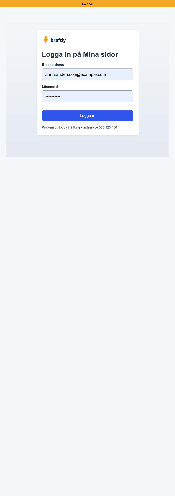
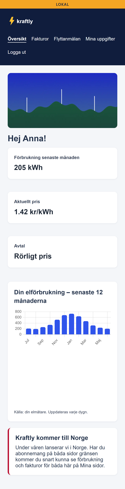
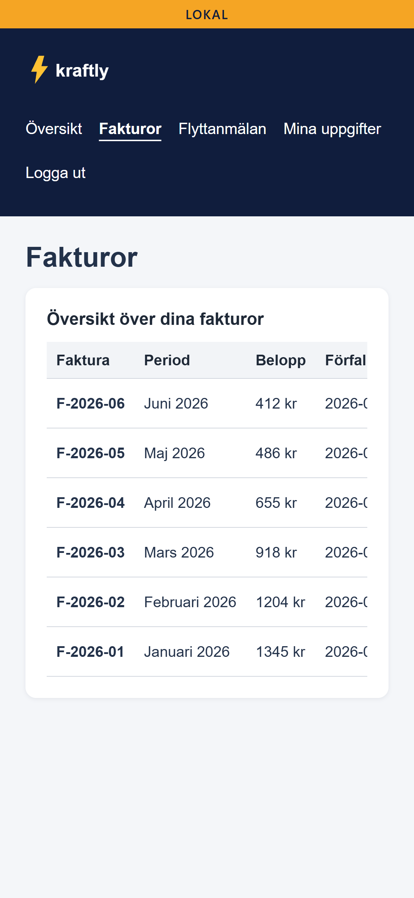
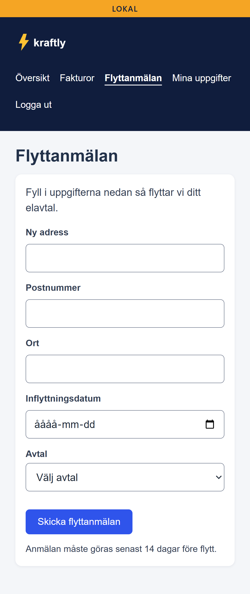
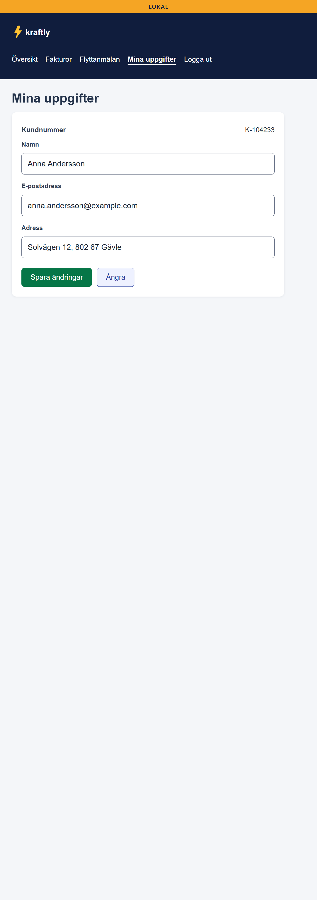
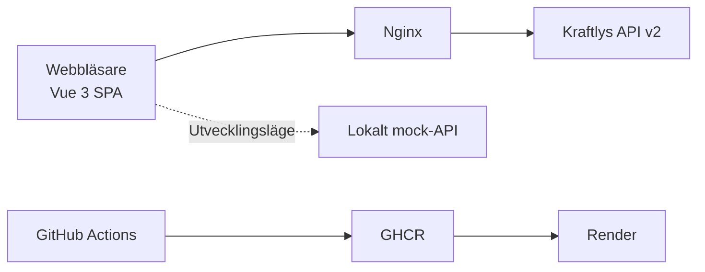

# Kraftly – Mina sidor

[](https://github.com/suzan-al-majdalawi/kraftly-suzan-team/actions/workflows/ci.yml)

Kundportal för Kraftly, ett elbolag. Applikationen levererades ursprungligen av Webbmakarna AB den 2026-06-30 och förvaltas av teamet sedan augusti 2026.

Kraftly Mina sidor är en webbapplikation där kunder kan logga in, se sina uppgifter, hantera fakturor och använda tjänster som flyttanmälan.

## Översikt

Applikationen är byggd med Vue 3 och Vite. Vue Router hanterar navigeringen och Pinia hanterar applikationens delade tillstånd.

Projektet använder bland annat:

- Vue 3, Vite, Vue Router och Pinia
- Nginx för frontend och API-proxy
- Kraftlys API v2 och ett mock-API för lokal utveckling
- GitHub Actions för automatiserade kontroller
- Docker och GitHub Container Registry (GHCR)
- Render för staging och produktion
- Vitest, Vue Test Utils, axe, Playwright och Storybook

## Miljöer

| Miljö      | Länk                                                                         |
| ---------- | ---------------------------------------------------------------------------- |
| Produktion | [Kraftly Production](https://kraftly-suzan-team-production-ny.onrender.com/) |
| Staging    | [Kraftly Staging](https://kraftly-suzan-team-staging-ny.onrender.com/)       |

Kontrollera alltid vilken commit som körs i miljön innan en release betraktas som verifierad.

## Skärmbilder – Mina sidor

Följande bilder visar applikationens huvudsakliga vyer.

<p align="center">
  
  
  
  
  
</p>

| Sida         | Route       |
| ------------ | ----------- |
| Inloggning   | `/login`    |
| Dashboard    | `/`         |
| Fakturor     | `/fakturor` |
| Flyttanmälan | `/flytt`    |
| Profil       | `/profil`   |

## Kom igång

### Förutsättningar

- Node.js 24
- npm
- Docker Desktop om du vill använda Docker

Alla lokala körsätt kräver en `.env`-fil med lokala värden. Den ska aldrig committas till Git.

Kopiera exempelkonfigurationen:

```bash
cp .env.example .env
cp .env.example mock-api/.env
```

## Kom igång

### Förutsättningar

- Node.js 24
- npm
- Docker Desktop om du vill använda Docker

Alla lokala körsätt kräver en `.env`-fil med lokala värden. Den ska aldrig committas till Git.

Kopiera exempelkonfigurationen:

```bash
cp .env.example .env
```

Om mock-API:t använder en separat `.env`-fil:

```bash
cp .env.example mock-api/.env
```

### Skapa JWT_SECRET

Generera en slumpmässig hemlighet:

```bash
node -e "console.log(require('crypto').randomBytes(32).toString('hex'))"
```

Kopiera resultatet till `JWT_SECRET` i `.env`.

Använd ett separat slumpmässigt värde för varje miljö. Lägg aldrig hemligheter i Git eller frontendkod.

### Med Docker (rekommenderat)

Starta applikationen från projektets rotkatalog:

```bash
docker compose up --build
```

Frontend nås på [http://localhost:8080](http://localhost:8080).

API-förfrågningar går via frontendens `/api`. Stoppa containrarna med:

```bash
docker compose down
```

### Utan Docker

Installera beroenden:

```bash
npm install
```

Starta mock-API:t i en terminal:

```bash
npm run api
```

Mock-API:t körs på port 4000.

Starta Vite i en annan terminal:

```bash
npm run dev
```

Öppna den adress som Vite visar, vanligtvis [http://localhost:5173](http://localhost:5173).

Använd `npm ci` installerar beroendena enligt `package-lock.json` och används för att få en reproducerbar installation. Om du ändrar beroenden lokalt kan du använda `npm install`.

## Inloggning

Applikationen använder autentisering via Kraftlys API v2.

- Access token lagras i minnet.
- Refresh token hanteras via en `HttpOnly`-cookie.
- Sessionen kan återställas via tokenförnyelse.
- Vue Router skyddar sidor som kräver inloggning.

Lokala testkonton:

| E-post                       | Lösenord       |
| ---------------------------- | -------------- |
| `anna.andersson@example.com` | `kraftly-anna` |
| `bo.bergstrom@example.com`   | `kraftly-bo`   |

Använd endast testkonton i avsedda testmiljöer.

Mer information finns i [säkerhetsdokumentationen](docs/security.md) och [beslutet om tokenlagring](docs/decisions/tokenlagring.md).

## Kvalitet

Kör relevanta tester innan du skickar in en pull request:

```bash
npm run test:run
npm run test:a11y
npm run lint
npm run build
```

Playwright kräver att Chromium är installerat:

```bash
npx playwright install chromium
npm run e2e:pw
```

Kontrollera kodformat:

```bash
npm run format:check
```

Storybook kan startas lokalt:

```bash
npm run storybook
```

Bygg Storybook:

```bash
npm run build-storybook
```

Projektet använder:

- **Vitest:** Enhets- och komponenttester.
- **Vue Test Utils:** Testning av Vue-komponenter.
- **axe:** Automatiserade tillgänglighetskontroller.
- **Playwright:** End-to-end-tester.
- **Storybook:** Dokumentation och isolerad visning av komponenter.

Automatiserade tillgänglighetstester ersätter inte en manuell granskning.

## Prestanda och hållbarhet – M7

Prestandamätningar och optimeringar dokumenteras i [performance](docs/performance.md).

CO₂-uppskattningen kan köras med:

```bash
npm run co2
```

Resultatet från den lokala körningen efter M7:

| Mätvärde                 | Resultat |
| ------------------------ | -------: |
| Datamängd per besök      |   334 kB |
| CO₂e per besök – Sverige |  0,020 g |
| CO₂e per månad – Sverige |   2,5 kg |
| CO₂e per månad – globalt |   6,2 kg |

Resultatet är en modellbaserad uppskattning. En jämförbar mätning före M7 saknas, så värdena visar inte en verifierad numerisk förbättring före och efter M7.

Se även [hållbarhetsdokumentationen](docs/sustainability.md).

## Arkitektur

Applikationen levereras som en Vue-baserad SPA. Nginx levererar frontendfiler och vidarebefordrar API-förfrågningar.



API-nycklar ska hanteras på serversidan och får inte exponeras i publika frontendfiler.

Mer information:

- [Systemarkitektur](docs/architecture.md)
- [CI/CD-pipeline](docs/pipeline.md)
- [Containerlösning](docs/containers.md)
- [Deployment](docs/deploy.md)

## CI/CD och deployment

GitHub Actions används för automatiserade kontroller och byggen. Docker-images publiceras till GHCR och används vid deployment.

Det planerade flödet är:

`GitHub → GitHub Actions → GHCR → Render`

Att en image har publicerats innebär inte automatiskt att rätt version körs i miljön. Kontrollera commit-SHA och driftsatt version.

Se [pipeline](docs/pipeline.md) och [deployment](docs/deploy.md) för mer information.

## Dokumentation

| Dokument                                 | Beskrivning                          |
| ---------------------------------------- | ------------------------------------ |
| [Arkitektur](docs/architecture.md)       | Systemets komponenter och relationer |
| [Pipeline](docs/pipeline.md)             | CI/CD och automatiserade kontroller  |
| [Containers](docs/containers.md)         | Docker och containerkonfiguration    |
| [Deployment](docs/deploy.md)             | Miljöer, secrets och rollback        |
| [Milstolpar](docs/milestones.md)         | Projektmål och acceptanskriterier    |
| [Readiness](docs/readiness.md)           | Status och verifieringsunderlag      |
| [Kända brister](docs/known-issues.md)    | Risker, begränsningar och nästa steg |
| [Prestanda](docs/performance.md)         | Prestandamätningar och optimeringar  |
| [Tillgänglighet](docs/accessibility.md)  | Tillgänglighetsarbete och tester     |
| [Säkerhet](docs/security.md)             | Autentisering och säkerhetsarbete    |
| [ADR-register](docs/decisions/README.md) | Arkitektoniska beslut                |

## Teamets arbetssätt

Projektet använder feature branches och pull requests.

Innan en pull request mergas ska:

- Relevanta tester ha körts.
- CI-kontrollerna ha godkänts.
- Ändringen ha granskats enligt teamets regler.
- Commit-meddelandet följa Conventional Commits.
- Ärendets acceptanskriterier vara uppfyllda.

Exempel på commit-meddelanden:

```bash
git commit -m "feat: add customer dashboard"
git commit -m "fix: resolve login issue"
git commit -m "docs: update README"
git commit -m "ci: add Storybook build"
```

## Säkerhet

- Lägg aldrig API-nycklar, lösenord eller token i Git.
- Lagra secrets i GitHub Actions Secrets eller motsvarande säker lagring.
- Använd testuppgifter endast i avsedda testmiljöer.
- Kontrollera att API-nycklar hanteras på serversidan.
- Exponera inte hemligheter i frontendfiler eller `config.js`.

## Projektinformation

**Projekt:** Kraftly – Mina sidor  
**Leverantör:** Webbmakarna AB  
**Ursprungligt leveransdatum:** 2026-06-30  
**Senast uppdaterad:** 2026-11-02
