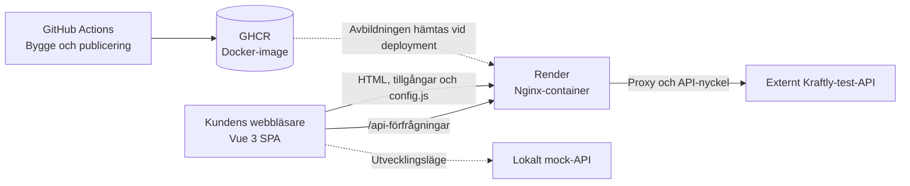

# Kraftly – Mina sidor

[](https://github.com/suzan-al-majdalawi/kraftly-suzan-team/actions/workflows/ci.yml)

Kundportal för Kraftly, ett elbolag. Applikationen levererades ursprungligen av Webbmakarna AB den 2026-06-30 och förvaltas av teamet sedan augusti 2026.

Kraftly Mina sidor är en webbapplikation där kunder kan logga in, se sina uppgifter, hantera fakturor och använda de tjänster som Kraftly erbjuder.

## Deployments

| Miljö      | Länk                                                                         |
| ---------- | ---------------------------------------------------------------------------- |
| Produktion | [Kraftly Production](https://kraftly-suzan-team-production-ny.onrender.com/) |
| Testmiljö  | [Kraftly Staging](https://kraftly-suzan-team-staging-ny.onrender.com/)       |

## Översikt

Applikationen är byggd med Vue 3 och använder Vue Router för navigering och Pinia för tillståndshantering.

Projektet innehåller bland annat:

- En Single Page Application (SPA) byggd med Vue 3.
- Klientbaserad navigering med Vue Router.
- Tillståndshantering med Pinia.
- Nginx för att leverera frontendfiler och vidarebefordra API-förfrågningar.
- Ett externt Kraftly-test-API och ett mock-API för lokal utveckling.
- GitHub Actions för automatiserade kontroller och byggen.
- Docker-images som publiceras till GitHub Container Registry (GHCR).
- Deployment till test- och produktionsmiljö via Render.
- Vitest, Vue Test Utils, axe och Playwright för testning.

## Skärmbilder – Mina sidor

Följande bilder visar applikationens huvudsakliga vyer.

| Sida         | Route       | Skärmbild                      |
| ------------ | ----------- | ------------------------------ |
| Inloggning   | `/login`    | `docs/img/sidor/login.png`     |
| Dashboard    | `/`         | `docs/img/sidor/dashboard.png` |
| Fakturor     | `/fakturor` | `docs/img/sidor/fakturor.png`  |
| Flyttanmälan | `/flytt`    | `docs/img/sidor/flytt.png`     |
| Profil       | `/profil`   | `docs/img/sidor/profil.png`    |

### Inloggning


### Dashboard


### Fakturor


### Flyttanmälan


### Profil


_Kontrollera att bildfilerna finns i `docs/img/sidor/` och att filnamnen stämmer med bilderna i projektet._

## Kom igång

### Förutsättningar

- Node.js 24.
- npm.
- Docker Desktop om du vill använda Docker.

Alla lokala körsätt kräver en `.env`-fil med lokala värden. Filen ska inte committas till Git.

Kopiera exempelkonfigurationen:

```bash
cp .env.example .env
```

### Alternativ 1 – Kör med Docker

Docker Compose rekommenderas för lokal körning.

1. Installera och starta Docker Desktop.
2. Öppna en terminal i projektets rotkatalog.
3. Kör:

```bash
docker compose up --build
```

Öppna sedan [http://localhost:8080](http://localhost:8080).

Frontend levereras via Nginx och API-förfrågningar vidarebefordras via `/api`.

Stoppa containrarna med:

```bash
docker compose down
```

Visa lokala Docker-images med:

```bash
docker image ls
```

### Alternativ 2 – Kör utan Docker

Installera beroendena:

```bash
npm install
```

Starta mock-API:t i en terminal:

```bash
npm run api
```

Mock-API:t körs på port 4000.

Starta Vite i en annan terminal:

```bash
npm run dev
```

Öppna den adress som Vite visar i terminalen, vanligtvis [http://localhost:5173](http://localhost:5173).

I utvecklingsläge vidarebefordras förfrågningar till `/api` till mock-API:t på port 4000.

Använd `npm ci` när du vill installera exakt de beroenden som anges i `package-lock.json`. Använd `npm install` när du avsiktligt vill ändra beroenden.

## Navigering i applikationen

Applikationen använder Vue Router för att navigera mellan vyerna.

| Route       | Funktion        | Åtkomst          |
| ----------- | --------------- | ---------------- |
| `/login`    | Inloggning      | Gäster           |
| `/`         | Dashboard       | Inloggade kunder |
| `/fakturor` | Fakturaöversikt | Inloggade kunder |
| `/flytt`    | Flyttanmälan    | Inloggade kunder |
| `/profil`   | Kundens profil  | Inloggade kunder |

Routern återställer användarens session innan den avgör om användaren ska få tillgång till en skyddad sida eller omdirigeras till inloggningen.

## Inloggning och autentisering

Applikationen använder autentisering via Kraftlys API v2 med e-postadress och lösenord.

- Access token lagras i minnet.
- Refresh token lagras i en `httpOnly`-cookie.
- Sessionen kan återställas genom anrop till `/auth/refresh`.
- Skyddade API-anrop använder access token.

Lokala testkonton:

| E-post                       | Lösenord       |
| ---------------------------- | -------------- |
| `anna.andersson@example.com` | `kraftly-anna` |
| `bo.bergstrom@example.com`   | `kraftly-bo`   |

Använd endast testkonton i avsedda testmiljöer.

Mer information finns i:

- [Säkerhetsdokumentation](docs/security.md)
- [Beslut om tokenlagring](docs/decisions/tokenlagring.md)

## Arkitektur

Följande diagram visar de viktigaste komponenterna och hur de samverkar.



### Huvudkomponenter

- **Vue 3:** Bygger kundgränssnittet.
- **Pinia:** Hanterar applikationens tillstånd.
- **Vue Router:** Hanterar navigeringen mellan vyerna.
- **Nginx:** Levererar byggda frontendfiler och vidarebefordrar API-förfrågningar.
- **GitHub Actions:** Kör CI-kontroller och bygger Docker-avbildningen.
- **GHCR:** Lagrar Docker-images.
- **Render:** Kör den driftsatta applikationen.
- **Externt API:** Tillhandahåller API-funktionalitet utanför teamets direkta ägarskap.
- **Mock-API:** Möjliggör lokal utveckling och testning.

Mer information:

- [Systemarkitektur](docs/architecture.md)
- [CI/CD-pipeline](docs/pipeline.md)
- [Containerlösning](docs/containers.md)
- [Deployment](docs/deploy.md)

## Kvalitet och testning

Kör relevanta tester innan du skickar in en pull request.

```bash
npm run test:run   # Enhets- och komponenttester med Vitest
npm run test:api   # API-tester med node:test
npm run test:a11y  # Tillgänglighetstester med axe
npm run storybook  # Startar Storybook
npm run e2e:pw     # E2E-smoke med Playwright
npm run build      # Produktionsbygge till dist/
```

För Playwright kan Chromium behöva installeras:

```bash
npx playwright install chromium
```

Projektet använder bland annat:

- **Vitest:** Enhets- och komponenttester.
- **Vue Test Utils:** Testning av Vue-komponenter.
- **axe:** Automatiserade tillgänglighetskontroller.
- **Playwright:** End-to-end-tester.
- **Storybook:** Visar och dokumenterar återanvändbara komponenter.

Automatiska tillgänglighetstester är ett hjälpmedel, men innebär inte i sig att hela applikationen uppfyller WCAG.

Mer information finns i [prestandadokumentationen](docs/performance.md) och [tillgänglighetsdokumentationen](docs/accessibility.md).

## CI/CD-pipeline

GitHub Actions-arbetsflödet definieras i `.github/workflows/ci.yml`.

Arbetsflödet innehåller bland annat:

- Tillgänglighetstester.
- Enhets- och komponenttester.
- Produktionsbygge.
- Storybook-bygge.
- Publicering av Docker-image till GHCR.
- Deployment till test- och produktionsmiljö.

Docker-imagen publiceras med en commit-SHA-tagg och taggen `main`.

Deployment och versionskontroll beskrivs i:

- [Pipeline](docs/pipeline.md)
- [Deployment](docs/deploy.md)
- [Milestones](docs/milestones.md)

## Lokal testning med Kubernetes (valfritt)

Kubernetes används som en valfri övning för lokal testning. Det är inte projektets standardmetod för deployment.

Konfigurationen finns i `k8s/kraftly.yaml`.

### Förutsättningar

- Docker Desktop med Kubernetes aktiverat.
- `kubectl` installerat.
- Åtkomst till rätt Docker-image i GHCR.
- En giltig API-nyckel från teamets säkra lagring.

### 1. Kontrollera klustret

I PowerShell:

```powershell
kubectl config use-context docker-desktop
kubectl get nodes
```

Kontrollera att nodens status är `Ready`.

### 2. Skapa en Secret

Använd en giltig API-nyckel från teamets säkra lagring:

```bash
kubectl create secret generic kraftly-secrets --from-literal=API_KEY=<DIN_API_NYCKEL>
```

Ersätt platshållaren med rätt nyckel. Lägg aldrig riktiga API-nycklar i Git eller README-filen.

Kontrollera om en Secret redan finns:

```bash
kubectl get secret kraftly-secrets
```

### 3. Kontrollera konfigurationen

Granska `k8s/kraftly.yaml` och verifiera att:

- Docker-imagen och dess tagg är korrekta.
- API-adressen pekar på rätt miljö.
- Deployment hämtar `API_KEY` från `kraftly-secrets`.
- Konfigurationen överensstämmer med applikationens krav.
- Åtkomst till GHCR är konfigurerad om imagen är privat.

### 4. Driftsätt applikationen

```bash
kubectl apply -f k8s/kraftly.yaml
```

### 5. Kontrollera status

```bash
kubectl get pods -w
kubectl get deployments
kubectl get services
```

Vid problem kan du undersöka detaljer och loggar:

```bash
kubectl describe pods
kubectl logs deployment/kraftly
```

### 6. Öppna applikationen

```bash
kubectl port-forward service/kraftly 8080:80
```

Öppna [http://localhost:8080](http://localhost:8080).

Låt terminalen vara öppen medan du testar.

### 7. Rensa testmiljön

```bash
kubectl delete -f k8s/kraftly.yaml
kubectl delete secret kraftly-secrets
```

Ta endast bort Secret-resursen om den inte längre behövs av andra resurser i klustret.

## AI-labben – vecka 10

AI-labben bygger vidare på Kraftly efter M8. Komponentbiblioteket innehåller återanvändbara komponenter som `KButton` och `KField`, Storybook-berättelser och tillgänglighetstester.

I labben kopplas en AI-granskare till utvecklingsflödet. Syftet är att undersöka hur användbar AI-granskning är och identifiera både träffar och missar innan man förlitar sig på resultatet.

Workflow, skript och SDK läggs till enligt övningens instruktioner. De ingår inte automatiskt i projektet.

Kom igång:

```bash
cp .env.example .env
npm install
npm run test:run
```

### Tre PR:ar att granska

Patchfilerna finns i `labb/`. Varje patch ska bli en separat gren och en pull request mot `main`. Öppna en PR i taget och invänta AI-kommentaren innan nästa öppnas.

Exempel för den första patchen:

```bash
git switch -c pr-a-kundnummer
git apply labb/pr-a-kundnummer.patch
git commit -am "Visa kundnummer och senaste faktura"
git push -u origin pr-a-kundnummer
gh pr create --fill
git switch main
```

| Patch                            | PR-titel                            | Ändrar                                                            |
| -------------------------------- | ----------------------------------- | ----------------------------------------------------------------- |
| `labb/pr-a-kundnummer.patch`     | Visa kundnummer och senaste faktura | `src/services/api.js`, `src/views/DashboardView.vue`              |
| `labb/pr-b-snabbare-lista.patch` | Snabbare fakturalista               | `src/views/InvoicesView.vue`, `package.json`, `package-lock.json` |
| `labb/pr-c-stada-testdata.patch` | Städa testdata                      | `src/services/api.test.js`                                        |

Läs diffen innan du läser AI-kommentaren. Jämför sedan din egen granskning med AI-resultatet och dokumentera träffar, missar och oavgjorda punkter i `labb/ai-utvardering.md`.

### API-nyckel för AI-granskning

Nyckeln `ANTHROPIC_API_KEY` ska läggas till som en GitHub Actions Secret under **Settings → Secrets and variables → Actions**.

Lokalt ska nyckeln endast finnas som en miljövariabel i terminalen. Lägg aldrig in den i en fil som committas, eller dela den i Slack eller Canvas.

### Lokal AI-granskning

När skriptet finns enligt övningens steg 2 kan granskningen köras lokalt utan GitHub:

```bash
git diff main...pr-a-kundnummer -- 'src/**' > diff.patch
node scripts/ai-review.mjs diff.patch
```

Detta använder samma typ av anrop som pipelinen.

## Staging och produktion

Labbrepot för AI-övningen har ingen egen stagingmiljö. Pipelinen kan innehålla deploy-jobb från Kraftly-projektet, men utan `RENDER_DEPLOY_HOOK` och `STAGING_URL` kan deploy-jobben misslyckas på `main`. Det är väntat i labbmiljön och påverkar inte AI-granskningen av pull requests.

Information om hur deployment, hemligheter och rollback fungerar finns i [docs/deploy.md](docs/deploy.md). Kontrollera att adresserna i dokumentet är uppdaterade och inte längre platshållare.

## Arkitektoniska beslut (ADR)

Viktiga tekniska beslut dokumenteras i `docs/decisions/`.

| Beslut                                                                                 | Beskrivning                          | Status     |
| -------------------------------------------------------------------------------------- | ------------------------------------ | ---------- |
| [ADR 001 – Rendering och hosting](docs/decisions/rendering.md)                         | Val av rendering och hosting         | Godkänt    |
| [ADR 002 – Tokenlagring](docs/decisions/tokenlagring.md)                               | Hur access- och refresh-token lagras | Godkänt    |
| [ADR 003 – Användarroller och behörigheter](docs/decisions/roller-och-behorigheter.md) | Roller och åtkomst till funktioner   | Föreslaget |
| [ADR 004 – Feature flags](docs/decisions/feature-flags.md)                             | Aktivering av funktioner per miljö   | Godkänt    |
| [ADR 005 – E2E-tester](docs/decisions/e2e-testing.md)                                  | Valet av Playwright för E2E-tester   | Godkänt    |

Läs [ADR-registret](docs/decisions/README.md) för mer information.

## Teamets arbetssätt

### Kommunikation och möten

Teamet samarbetar för att lösa problem och använder överenskomna kommunikationskanaler, exempelvis Slack, för frågor och mötessamordning.

### Git-arbetsflöde

- Använd kortlivade feature branches.
- Gör ändringar genom pull requests.
- Be minst en teammedlem att granska ändringarna före sammanslagning, enligt teamets regler.
- Håll feature-branchen uppdaterad med `main`.

### Checklista för pull requests

Beskriv följande i varje pull request:

- Vilken uppgift eller vilket ärende ändringen gäller.
- Vad som har ändrats.
- Varför ändringen behövdes.
- Hur ändringen kan testas.

Kontrollera före sammanslagning att:

- Relevanta tester har körts.
- CI-kontrollerna har godkänts.
- Commit-meddelandet följer Conventional Commits.
- Branchen baseras på en uppdaterad version av `main`.
- Ärendets acceptanskriterier är uppfyllda.
- Nödvändiga granskningar och GitHub-regler är uppfyllda.

### Conventional Commits

Exempel:

```bash
git commit -m "feat: add customer dashboard"
git commit -m "fix: resolve login issue"
git commit -m "docs: update README"
git commit -m "ci: add Storybook build"
```

Commit-meddelanden skrivs på engelska enligt teamets överenskomna konvention.

## Dokumentation

| Dokument                                 | Beskrivning                                    |
| ---------------------------------------- | ---------------------------------------------- |
| [Systemarkitektur](docs/architecture.md) | Systemarkitektur och komponenternas relationer |
| [CI/CD-pipeline](docs/pipeline.md)       | CI/CD-arbetsflöde och deployment               |
| [Containerlösning](docs/containers.md)   | Docker och containerkonfiguration              |
| [Deployment](docs/deploy.md)             | Miljöer, hemligheter och rollback              |
| [Milstolpar](docs/milestones.md)         | Projektmål och acceptanskriterier              |
| [Prestanda](docs/performance.md)         | Prestandamätningar och resultat                |
| [Tillgänglighet](docs/accessibility.md)  | Tillgänglighetsarbete och tester               |
| [Säkerhet](docs/security.md)             | Autentisering och säkerhetsarbete              |
| [ADR-register](docs/decisions/README.md) | Samlade arkitektoniska beslut                  |
| [AI i pipelinen](docs/ai-in-pipeline.md) | AI-stödd granskning och begränsningar          |

Kontrollera att samtliga länkade filer finns i projektet innan ändringarna slås samman.

## Projektmilstolpar

### M3 – Kom igång och dokumentation

README beskriver lokal installation, Docker, valfri Kubernetes-testning, deployment och teamets arbetsflöde.

### M5 – Deployment

Deployment och versionsverifiering dokumenteras i `docs/pipeline.md` och `docs/milestones.md`.

### M7 – Prestanda

Prestandaarbete och mätresultat dokumenteras i `docs/performance.md` och `docs/decisions/rendering.md`.

### M8 – Tillgänglighet

Tillgänglighetsarbetet och dess verifieringsstatus dokumenteras i `docs/milestones.md` och tillgänglighetsdokumentationen.

### M9 – Återanvändbara fält och Storybook

Återanvändbara fältkomponenter, Storybook-berättelser, tillgänglighetstester och CI-artefakten för Storybook följs upp i `docs/milestones.md`.

## Säkerhet

- Lägg aldrig API-nycklar, åtkomsttoken eller andra hemligheter i Git.
- Lagra deploymentsnycklar och autentiseringsuppgifter i GitHub Actions Secrets eller motsvarande säker lagring.
- Använd testuppgifter endast i avsedda testmiljöer.
- Publicera aldrig lösenord i README-filen.
- Kontrollera att API-nycklar hanteras på serversidan och inte exponeras i publika frontendfiler.
- Kontrollera att proxykonfigurationen hanterar autentisering och känsliga uppgifter på ett säkert sätt.

---

**Projekt:** Kraftly – Mina sidor  
**Leverantör:** Webbmakarna AB  
**Ursprungligt leveransdatum:** 2026-06-30  
**Senast uppdaterad:** 2026-10-30
