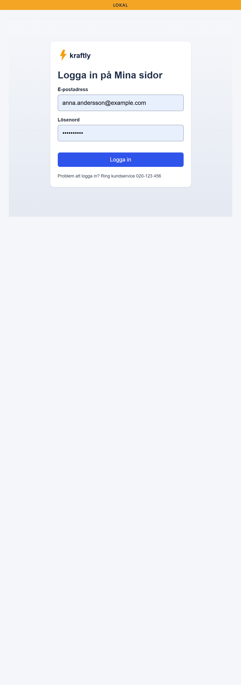
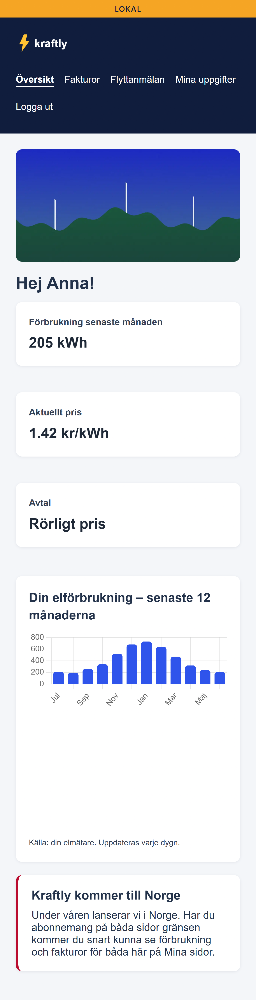
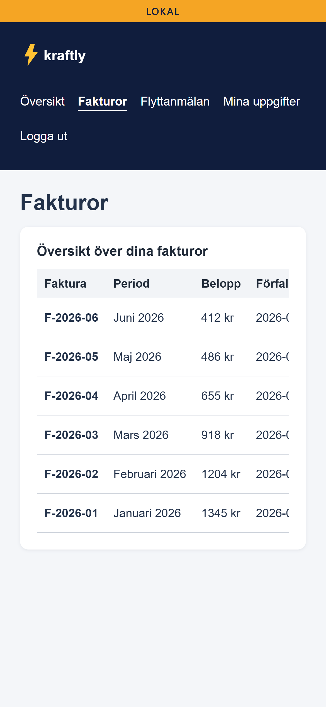
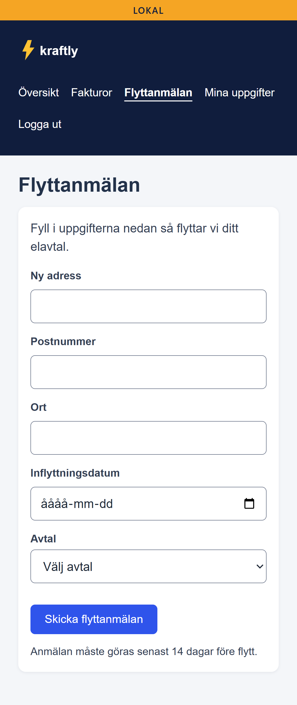
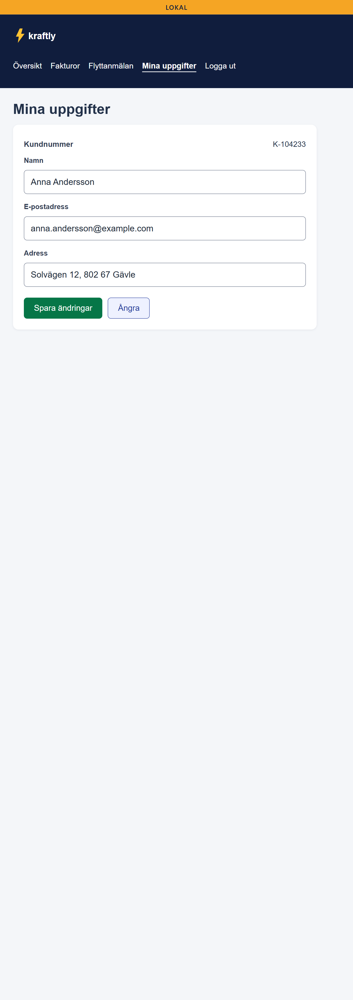
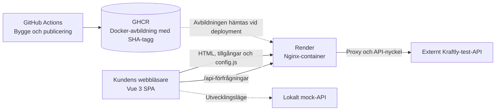

# Kraftly Mina sidor

Customer portal for Kraftly. Delivered by Webbmakarna AB 2026-06-30.

[](https://github.com/suzan-al-majdalawi/kraftly-suzan-team/actions/workflows/ci.yml)

Kundportal för Kraftly, levererad av Webbmakarna AB.

Kraftly Mina sidor är en webbapplikation där kunder kan logga in på sitt konto, navigera mellan olika sidor och använda de tjänster som Kraftly erbjuder.

## Deployments

| Miljö      | Länk                                                                         |
| ---------- | ---------------------------------------------------------------------------- |
| Produktion | [Kraftly Production](https://kraftly-suzan-team-production-ny.onrender.com/) |
| Testmiljö  | [Kraftly Staging](https://kraftly-suzan-team-staging-ny.onrender.com/)       |

## Översikt

Kraftly Mina sidor är byggd med Vue 3 och tillhandahåller ett användargränssnitt för Kraftlys kunder. Applikationen använder Vue Router för navigering och Pinia för tillståndshantering.

Projektet innehåller:

- En single-page application (SPA) byggd med Vue 3.
- Klientbaserad navigering och hantering av applikationens tillstånd.
- Nginx för att leverera frontendfiler och vidarebefordra API-förfrågningar.
- Ett externt Kraftly-test-API samt ett mock-API för lokal utveckling.
- GitHub Actions för automatiserade kontroller och byggen.
- Docker-images som publiceras till GitHub Container Registry (GHCR).
- Deployment till test- och produktionsmiljö via Render.

## Skärmbilder – Mina sidor

Här visas applikationens huvudsakliga vyer. Skärmbilderna hjälper läsaren att förstå gränssnittet och hur kunden navigerar mellan funktionerna.

| Sida         | Route       | Skärmbild                      |
| ------------ | ----------- | ------------------------------ |
| Inloggning   | `/login`    | `docs/img/sidor/login.png`     |
| Dashboard    | `/`         | `docs/img/sidor/dashboard.png` |
| Fakturor     | `/fakturor` | `docs/img/sidor/fakturor.png`  |
| Flyttanmälan | `/flytt`    | `docs/img/sidor/flytt.png`     |
| Profil       | `/profil`   | `docs/img/sidor/profil.png`    |

### Inloggning



### Dashboard



### Fakturor



### Flyttanmälan



### Profil



**Obs!** Lägg endast in länkar till skärmbilder som faktiskt finns i katalogen `docs/img/sidor/`. Filnamnen ovan är förslag och ska stämma överens med de bilder som sparas i projektet.

## Kom igång

### Förutsättningar

- Node.js 24.
- npm.
- Docker Desktop om du vill köra applikationen med Docker.

### Alternativ 1 – Kör med Docker

Docker Compose rekommenderas för lokal körning av projektet.

1. Installera och starta Docker Desktop.
2. Öppna en terminal i projektets rotkatalog.
3. Kör följande kommando:

```bash
docker compose up --build
```

Öppna sedan [http://localhost:8080](http://localhost:8080).

Frontend-applikationen levereras via Nginx och mock-API:t körs i en separat container.

Stoppa containrarna med:

```bash
docker compose down
```

Visa lokala Docker-images med:

```bash
docker image ls
```

### Alternativ 2 – Kör utan Docker

Installera beroendena:

```bash
npm ci
```

Starta mock-API:t i en terminal:

```bash
npm run api
```

Starta utvecklingsservern i en annan terminal:

```bash
npm run dev
```

Öppna [http://localhost:5173](http://localhost:5173).

I utvecklingsläge vidarebefordras förfrågningar till `/api` till mock-API:t på port 4000.

Använd `npm ci` för reproducerbar installation när en giltig `package-lock.json` finns. Använd `npm install` när du avsiktligt vill uppdatera beroendena.

## Navigering i applikationen

Applikationen använder Vue Router för att navigera mellan vyerna.

Följande routes är definierade:

- `/login` – inloggning för gäster.
- `/` – kundens dashboard.
- `/fakturor` – översikt över fakturor.
- `/flytt` – formulär för flyttanmälan.
- `/profil` – kundens profil.

De fyra kundvyerna kräver autentisering, medan `/login` är avsedd för användare som inte är inloggade. Routern försöker även återställa användarens session innan den avgör om användaren ska omdirigeras till inloggningen.

När ett användarflöde dokumenteras ska den faktiska navigeringsvägen och det förväntade resultatet beskrivas. Exempel:

1. Öppna applikationen.
2. Logga in med giltiga testuppgifter.
3. Navigera till önskad sida via applikationens meny.
4. Välj relevant funktion eller fyll i formuläret.
5. Kontrollera att rätt sida eller resultat visas.

Verifiera routes och beteenden i den faktiska applikationen innan dokumentationen uppdateras.

## Arkitektur

Följande diagram visar de viktigaste komponenterna och hur de samverkar.



### Huvudkomponenter

- **Vue 3:** Bygger kundgränssnittet.
- **Pinia:** Hanterar applikationens tillstånd.
- **Vue Router:** Hanterar navigeringen mellan vyerna.
- **Nginx:** Levererar byggda frontendfiler och vidarebefordrar API-förfrågningar.
- **GitHub Actions:** Kör CI-kontroller och bygger Docker-avbildningen.
- **GHCR:** Lagrar och distribuerar Docker-images.
- **Render:** Kör den driftsatta applikationen.
- **Externt API:** Tillhandahåller API-funktionalitet utanför teamets direkta ägarskap.
- **Mock-API:** Möjliggör lokal utveckling och testning.

Mer information finns i:

- [Systemarkitektur](docs/architecture.md)
- [CI/CD-pipeline](docs/pipeline.md)

## Lokal testning med Kubernetes (valfritt)

Kubernetes används som en valfri övning för lokal testning. Det är inte projektets standardmetod för deployment.

Konfigurationen finns i `k8s/kraftly.yaml`.

### Förutsättningar

- Docker Desktop med Kubernetes aktiverat.
- `kubectl` installerat.
- Åtkomst till rätt Docker-avbildning i GHCR.
- En giltig API-nyckel från teamets säkra lagring.

### 1. Kontrollera klustret

Kör följande kommandon i PowerShell:

```powershell
kubectl config use-context docker-desktop
kubectl get nodes
```

Kontrollera att nodens status är `Ready`.

### 2. Skapa en Secret för API-nyckeln

Kör följande kommando med en giltig API-nyckel från teamets säkra lagring:

```bash
kubectl create secret generic kraftly-secrets --from-literal=API_KEY=<DIN_API_NYCKEL>
```

Ersätt platshållaren med rätt nyckel. Lägg aldrig riktiga API-nycklar i Git eller i README-filen.

Om en Secret redan finns kan du kontrollera den med:

```bash
kubectl get secret kraftly-secrets
```

### 3. Kontrollera konfigurationen

Granska `k8s/kraftly.yaml` och verifiera att:

- Docker-avbildningen och dess tagg är korrekta.
- API-adressen pekar på rätt miljö.
- Deployment hämtar `API_KEY` från `kraftly-secrets`.
- Konfigurationen överensstämmer med applikationens krav.
- Åtkomst till GHCR är konfigurerad om avbildningen är privat.

### 4. Driftsätt applikationen

Kör följande kommando från projektets rotkatalog:

```bash
kubectl apply -f k8s/kraftly.yaml
```

### 5. Kontrollera status

```bash
kubectl get pods -w
kubectl get deployments
kubectl get services
```

Om en Pod inte startar kan du undersöka detaljer och loggar:

```bash
kubectl describe pods
kubectl logs deployment/kraftly
```

### 6. Öppna applikationen

```bash
kubectl port-forward service/kraftly 8080:80
```

Öppna [http://localhost:8080](http://localhost:8080).

Låt terminalen vara öppen medan du testar.

### 7. Rensa testmiljön

```bash
kubectl delete -f k8s/kraftly.yaml
kubectl delete secret kraftly-secrets
```

Ta endast bort Secret-resursen om den inte längre behövs av andra resurser i klustret.

## CI/CD-pipeline

GitHub Actions-arbetsflödet definieras i `.github/workflows/ci.yml`.

### Kontroller och bygge

Arbetsflödet innehåller bland annat följande kontroller:

- Tillgänglighetstester med `npm run test:a11y`.
- Applikationstester med `npm run test:run`.
- Produktionsbygge med `npm run build`.
- Storybook-bygge med `npm run build-storybook`.

Storybook-bygget laddas upp som en artefakt med namnet `storybook-static`.

### Publicering av avbildning och deployment

Vid push till `main` bygger arbetsflödet en Docker-image och publicerar den till GHCR med både en commit-SHA-tagg och taggen `main`.

Deploymentsprocessen består av följande steg:

1. Bygg och publicera Docker-imagenen.
2. Driftsätt till testmiljön.
3. Verifiera den driftsatta versionen med `version.txt`.
4. Driftsätt till produktion efter att jobbet för testmiljön har lyckats.
5. Verifiera produktionsversionen och kontrollera flaggan `FEATURE_NORWAY`.

De faktiska kraven för sammanslagning av pull requests styrs av reglerna i GitHub-repositoriet och ska kontrolleras där.

Mer information finns i [dokumentationen för CI/CD-pipelinen](docs/pipeline.md).

## Testning

Kör relevanta tester innan du skickar in en pull request:

```bash
npm run test:a11y
npm run test:run
npm run build
npm run build-storybook
```

Ange endast att testerna har godkänts när de faktiskt har körts och slutförts utan fel.

Automatiska tillgänglighetstester är ett viktigt hjälpmedel men utgör inte i sig ett bevis på fullständig WCAG-efterlevnad.

## Teamets arbetssätt

### Kommunikation

Vi samarbetar för att lösa problem och ber om hjälp i teamets överenskomna kommunikationskanal vid behov.

### Möten

Mötestider samordnas via Slack eller någon annan kommunikationskanal som teamet har kommit överens om.

### Git-arbetsflöde

- Använd kortlivade feature branches.
- Gör ändringar genom pull requests.
- Be minst en teammedlem att granska ändringarna före sammanslagning, enligt teamets regler.
- Håll feature-branchen uppdaterad med `main`.

### Checklista för pull requests

Varje pull request bör beskriva:

- Vilken uppgift eller vilket ärende ändringen gäller.
- Vad som har ändrats.
- Varför ändringen behövdes.
- Hur ändringen kan testas.

Kontrollera före sammanslagning att:

- Relevanta tester har körts.
- CI-kontrollerna har godkänts.
- Commit-meddelandet följer Conventional Commits.
- Branchen baseras på en uppdaterad version av `main`.
- Ärendets acceptanskriterier är uppfyllda.
- Nödvändiga granskningar och regler i GitHub är uppfyllda.

### Conventional Commits

Exempel på commit-meddelanden:

```bash
git commit -m "feat: add customer dashboard"
git commit -m "fix: resolve login issue"
git commit -m "docs: update README"
git commit -m "ci: add Storybook build"
```

Commit-meddelandena kan skrivas på engelska enligt teamets överenskomna konvention.

## Dokumentation

| Dokument                                                   | Beskrivning                                            |
| ---------------------------------------------------------- | ------------------------------------------------------ |
| [docs/architecture.md](docs/architecture.md)               | Systemarkitektur och komponenternas relationer         |
| [docs/pipeline.md](docs/pipeline.md)                       | CI/CD-arbetsflöde och deployment                       |
| [docs/milestones.md](docs/milestones.md)                   | Projektmål och acceptanskriterier                      |
| [docs/performance.md](docs/performance.md)                 | Prestandamätningar och resultat                        |
| [docs/decisions/rendering.md](docs/decisions/rendering.md) | Beslut och motiveringar kring rendering                |
| [docs/sustainability.md](docs/sustainability.md)           | Uppskattningar och antaganden kring hållbarhet         |
| [docs/ai-in-pipeline.md](docs/ai-in-pipeline.md)           | AI-stödd granskning av pipeline och dess begränsningar |

Kontrollera att samtliga länkade filer finns i projektet innan ändringarna slås samman.

## Projektmilstolpar

### M3 – Kom igång och dokumentation

README-filen beskriver lokal installation, Docker, valfri Kubernetes-testning, deployment och teamets arbetsflöde.

### M5 – Deployment

Deployment och versionsverifiering dokumenteras i `docs/pipeline.md` och `docs/milestones.md`. Kontrollera att dokumentationen överensstämmer med det aktuella arbetsflödet.

### M7 – Prestanda

Prestandaarbete och mätresultat dokumenteras i `docs/performance.md` och `docs/decisions/rendering.md`.

### M8 – Tillgänglighet

Tillgänglighetsarbetet och dess verifieringsstatus dokumenteras i `docs/milestones.md` och projektets tillgänglighetsanalys. Godkända automatiska tester ska inte tolkas som bevis på fullständig WCAG-efterlevnad.

### M9 – Återanvändbara fält och Storybook

Återanvändbara fältkomponenter, Storybook-berättelser, tillgänglighetstester och CI-artefakten för Storybook följs upp i `docs/milestones.md`.

## Säkerhet

- Lägg aldrig API-nycklar, åtkomsttoken eller andra hemligheter i Git.
- Lagra deploymentsnycklar och autentiseringsuppgifter i GitHub Actions Secrets eller motsvarande säker lagring.
- Använd testuppgifter endast i avsedd testmiljö.
- Publicera aldrig lösenord i README-filen.
- Kontrollera att API-nycklar hanteras på serversidan och inte exponeras i publika frontendfiler.
- Kontrollera att proxykonfigurationen hanterar autentisering och känsliga uppgifter på ett säkert sätt.

---

**Projekt:** Kraftly Mina sidor  
**Leverantör:** Webbmakarna AB  
**Dokumentationsdatum:** 2026-06-30
