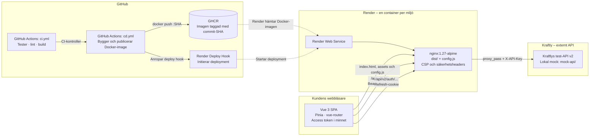
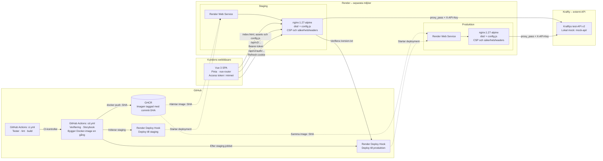

# Architecture – Kraftly Mina sidor

## Översikt

Systemet består av en Vue 3 Single Page Application (SPA), en Nginx-container som serverar frontend-filer och vidarebefordrar API-anrop, samt Kraftlys externa test-API.

Docker-imagen byggs i GitHub Actions, publiceras till GitHub Container Registry (GHCR) och hämtas av Render vid deployment.

GitHub Actions ansvarar för CI- och CD-processerna. `ci.yml` kör kvalitetskontroller. `cd.yml` bygger och publicerar Docker-imagen samt initierar deployment till Render.

## 1. Architecture diagram – Systemöversikt

Detta diagram visar systemets komponenter, webbläsaren, Nginx och API-kommunikationen.

## 2. Architecture diagram – CI/CD och deployment

Detta diagram visar hur CI-kontrollerna och CD-processen fungerar, hur Docker-imagen publiceras till GHCR och hur samma image används i staging och produktion.

## Komponenter

### Vue 3 SPA

- Vue 3 används för användargränssnittet.
- Pinia hanterar applikationens tillstånd.
- vue-router hanterar navigering.
- Access token lagras i minnet.
- Frontendens API-anrop skickas via Nginx.
- Refresh-cookie används för autentiseringsflödet enligt projektets konfiguration.

### Nginx

- Serverar frontendens byggda filer från `dist/`.
- Serverar `config.js`, som används för frontendens runtime-konfiguration.
- Vidarebefordrar API-anrop till det externa API:t med `proxy_pass`.
- Hanterar CSP och säkerhetsheaders.
- Konfigurerar vidarebefordran av `X-API-Key` till det externa API:t.

### GitHub Actions och GHCR

Projektet använder två GitHub Actions-workflows med olika ansvarsområden.

**CI – `.github/workflows/ci.yml`**

- Kör automatiserade tester.
- Kör tillgänglighetstester.
- Bygger Vue-applikationen.
- Sparar `dist/` som ett artifact.

**CD – `.github/workflows/cd.yml`**

CD-workflowen ansvarar för verifiering, byggande och deployment.

- Kör tester och tillgänglighetstester i jobbet `verify`.
- Bygger Storybook och sparar det som ett artifact.
- Bygger Docker-imagen efter godkända kontroller.
- Taggar imagen med commitens SHA och även med taggen `main`.
- Publicerar imagen till GitHub Container Registry (GHCR).
- Deployar imagen till staging via Render Deploy Hook.
- Kontrollerar att staging kör rätt commit genom att läsa `/version.txt`.
- Deployar samma SHA-taggade image till produktion.
- Kontrollerar produktionens version och att Norge-flaggan är avstängd.

Docker-imagen byggs en gång i CD-workflowen och återanvänds i staging och produktion. Den byggs inte om mellan miljöerna.

GHCR används som container registry för projektets Docker-images.

### Render

Render används för att köra applikationens container i respektive miljö.

Render hämtar Docker-imagen från GHCR och startar applikationen vid deployment.

Enligt projektets deployment-konfiguration används staging före produktion.

Deployment initieras via en Render Deploy Hook från GitHub Actions.

### Externt API

Kraftlys test-API v2 ligger utanför teamets ägarskap.

Under lokal utveckling kan en mock-API användas för att simulera API-kommunikation.

Den externa API-kommunikationen sker via Nginx, som fungerar som reverse proxy mellan frontend och API.

## API-kommunikation och säkerhet

Frontend skickar API-anrop via Nginx.

Nginx vidarebefordrar anropen till Kraftlys externa test-API v2 med `proxy_pass` och konfigurerar `X-API-Key`.

Access token lagras i minnet och används för autentiserade API-anrop.

Refresh-cookie används endast för autentiseringsflödet enligt projektets konfiguration. I diagrammet representeras detta av anrop till `/api/v2/auth/`.

API-nycklar ska hanteras på serversidan och inte exponeras i frontendens publika filer.

Nginx ansvarar för att vidarebefordra API-anrop och tillämpa de säkerhetsinställningar som definierats i projektets konfiguration.

## Lagren i frontend

| Lager         | Ansvar                         | Regel                                                                                                                       |
| ------------- | ------------------------------ | --------------------------------------------------------------------------------------------------------------------------- |
| `views/`      | Sidor som routern visar        | Anropar normalt stores. Undantag: `InvoicesView.vue`, `LoginView.vue` och `MoveFormView.vue` anropar `services/api` direkt. |
| `components/` | Återanvändbara UI-komponenter  | Sökningen efter `services/` gav inga direkta träffar i `src/components`.                                                    |
| `stores/`     | Delat tillstånd mellan vyer    | Hanterar tillstånd och kan anropa `services/` för API-kommunikation.                                                        |
| `services/`   | Kommunikation med API:t        | Innehåller API-funktioner, exempelvis `fetchInvoices`, `login` och `submitMove`.                                            |
| `utils/`      | Återanvändbara hjälpfunktioner | Innehåller gemensam logik.                                                                                                  |
| `router/`     | Navigation och rutter          | Hanterar navigering mellan vyerna.                                                                                          |

Den avsedda riktningen för dataflödet är `views → stores → services`. Tre vyer gör dock direkta anrop till `services/api`: `InvoicesView.vue`, `LoginView.vue` och `MoveFormView.vue`. Dessa är dokumenterade undantag från lagerprincipen.

## Miljöer

| Miljö        | Adress                                                   | Uppdateras                  | Norge-flaggan                     | API                                            |
| ------------ | -------------------------------------------------------- | --------------------------- | --------------------------------- | ---------------------------------------------- |
| Dev (lokalt) | `http://localhost:5173` eller enligt lokal konfiguration | Vid lokal utveckling        | Enligt lokal konfiguration        | Mock-API eller test-API                        |
| Staging      | Er faktiska staging-adress                               | Enligt deployment-pipelinen | Enligt staging-konfigurationen    | Kraftlys test-API v2                           |
| Prod         | Er faktiska produktionsadress                            | Efter godkänd deployment    | Enligt produktionskonfigurationen | Kraftlys API enligt deployment-konfigurationen |

Staging används före produktion enligt projektets deployment-konfiguration. Kontrollera miljöernas adresser, API och feature flag mot Render och projektets konfiguration innan tabellen färdigställs.

## Deployment-flöde

Deployment-flödet består av följande steg:

1. En ändring pushas till GitHub.
2. GitHub Actions kör CI-workflowen.
3. Docker-imagen byggs och taggas med commitens SHA.
4. Imagen publiceras till GHCR.
5. GitHub Actions anropar Render via en Deploy Hook.
6. Render hämtar Docker-imagen från GHCR.
7. Render deployar imagen i aktuell miljö.
8. Nginx startar och serverar frontendens byggda filer samt vidarebefordrar API-anrop.

Staging används före produktion enligt projektets deployment-konfiguration.

## Begränsningar

Diagrammet visar systemets huvudsakliga komponenter och kommunikationsvägar.

Det beskriver den avsedda arkitekturen, men exakta detaljer om följande ska verifieras mot den faktiska implementationen:

- Tokenhantering och autentiseringsflöde.
- Cookie-attribut, exempelvis `HttpOnly`, `Secure` och `SameSite`.
- API-rutter och vidarebefordran av headers.
- Hantering och lagring av API-nycklar.
- Nginx-konfiguration och säkerhetsheaders.
- GitHub Actions-workflow och deployment-hook.
- Render-konfiguration och miljöhantering.

Dokumentationen ska hållas uppdaterad när implementationen eller deployment-konfigurationen förändras.

## Beslut

Arkitekturens viktigaste beslut dokumenteras i
[`docs/decisions/`](decisions/README.md).

- [Hosting](decisions/hosting.md) – Render, Docker, GHCR och deployment.
- [Tokenlagring](decisions/tokenlagring.md) – access token och refresh-cookie.
- [Feature flags](decisions/feature-flags.md) – runtime-konfiguration för Norge.
- [Rendering](decisions/rendering.md) – varför vi behåller Vue SPA med Vite.
- [E2E-tester](decisions/testing.md) – varför vi använder Playwright.
- [Tillgänglighetsanalys](decisions/tillganglighetsanalys.md) – riskområden, åtgärdsplan och verifiering av tillgänglighet.
