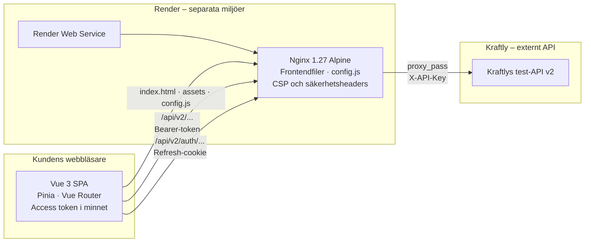
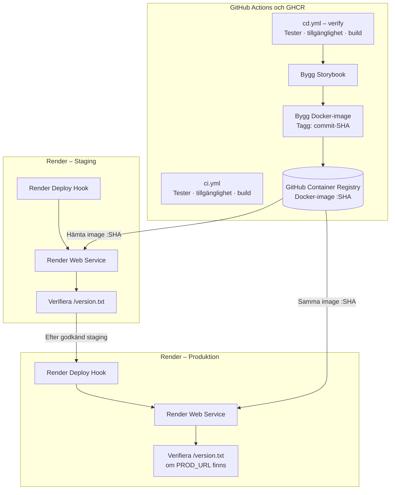

# Architecture – Kraftly Mina sidor

## Översikt

Kraftly Mina sidor är en Vue 3 Single Page Application (SPA). Frontend-applikationen byggs till statiska filer som serveras av Nginx i en Docker-container. Nginx fungerar även som reverse proxy för API-anrop till Kraftlys externa test-API v2.

Docker-imagen byggs i GitHub Actions, publiceras till GitHub Container Registry (GHCR) och hämtas av Render vid deployment.

Projektet använder två GitHub Actions-workflows:

- `ci.yml` kör separata kvalitetskontroller.
- `cd.yml` ansvarar för verifiering, byggande och publicering av Docker-imagen samt deployment till staging och produktion.

Samma SHA-taggade Docker-image används i båda miljöerna. Staging deployas och verifieras innan samma image deployas till produktion.

## 1. Architecture diagram – Systemöversikt

Diagrammet visar systemets huvudsakliga komponenter och kommunikationen mellan webbläsaren, frontend, Nginx och det externa API:t.

## 2. Architecture diagram – CI/CD och deployment

Diagrammet visar hur CD-workflowen verifierar projektet, bygger Docker-imagen, publicerar den till GHCR och deployar samma image till staging och produktion.

`ci.yml` och `cd.yml` är separata workflows. `cd.yml` innehåller egna verifieringssteg innan deployment. Diagrammet visar deras huvudsakliga ansvarsområden utan att påstå att `ci.yml` automatiskt startar `cd.yml`.

## 3. Komponenter

### Vue 3 SPA

Frontend-applikationen består av:

- **Vue 3** – bygger användargränssnittet.
- **Pinia** – hanterar delat applikationstillstånd.
- **Vue Router** – hanterar navigering och skyddade rutter.
- **Services** – samlar funktioner för API-kommunikation.
- **Access token** – lagras i minnet och används vid autentiserade API-anrop.
- **Refresh-cookie** – används i autentiseringsflödet enligt API-konfigurationen.

Frontendens API-anrop går via Nginx i stället för direkt till det externa API:t.

### Nginx

Nginx används både för att servera frontendens byggda filer och som reverse proxy för API-kommunikation.

Nginx ansvarar för att:

- Lyssna på porten som anges av miljövariabeln `PORT`.
- Servera frontendens byggda filer från `/usr/share/nginx/html`.
- Hantera Vue SPA-routing med `try_files`, så att klientbaserade rutter fungerar vid direkt navigering och omladdning.
- Servera runtime-konfigurationen `config.js`.
- Vidarebefordra anrop under `/api/` till det externa API:t med `proxy_pass`.
- Lägga till API-nyckeln i headern `X-Api-Key`.
- Aktivera SNI för HTTPS-baserad API-kommunikation.
- Använda en lästimeout på 90 sekunder för API-anrop.

#### Cachehantering

Nginx använder olika cacheinställningar beroende på filtyp:

| Filtyp         | Cacheinställning                      | Syfte                                                                                    |
| -------------- | ------------------------------------- | ---------------------------------------------------------------------------------------- |
| `/assets/`     | `public, max-age=31536000, immutable` | Hashade filer kan cachas i ett år.                                                       |
| `/index.html`  | `no-cache`                            | Säkerställer att webbläsaren kontrollerar aktuell version innan en cachad kopia används. |
| `/config.js`   | `no-cache`                            | Säkerställer att runtime-inställningar och feature flags kan uppdateras.                 |
| `/version.txt` | `no-cache`                            | Säkerställer att versionskontrollen inte använder ett gammalt cachelagrat värde.         |

`no-cache` innebär att webbläsaren får lagra filen men måste kontrollera med servern innan den använder en cachad kopia.

#### Säkerhetsheaders

Alla definierade locations inkluderar `/etc/nginx/security-headers.conf`.

Filen innehåller projektets säkerhetsheaders, bland annat Content-Security-Policy (CSP), HSTS, X-Frame-Options, X-Content-Type-Options och Referrer-Policy.

### Runtime-konfiguration

Vid containerstart genereras `config.js` utifrån miljövariablerna `APP_ENV` och `FEATURE_NORWAY`.

Det gör det möjligt att använda samma Docker-image i olika miljöer utan att bygga om imagen.

`FEATURE_NORWAY` är en publik feature flag. Om variabeln saknas eller inte har värdet `true` är funktionen avstängd.

API-nyckeln skickas av Nginx på serversidan och får inte exponeras i `config.js` eller andra publika frontendfiler.

### GitHub Actions och GHCR

Projektet använder två workflows med olika ansvarsområden.

#### CI – `.github/workflows/ci.yml`

CI-workflowen kör kvalitetskontroller vid relevanta push- och pull request-händelser.

Den omfattar bland annat:

- Installation av beroenden med `npm ci`.
- Tillgänglighetstester.
- Automatiserade tester.
- Byggande av Vue-applikationen.

#### CD – `.github/workflows/cd.yml`

CD-workflowen ansvarar för verifiering, byggande, publicering och deployment.

Flödet omfattar:

1. Kör tester, tillgänglighetstester och byggkontroller i `verify`.
2. Bygger Storybook och sparar resultatet som artifact.
3. Bygger Docker-imagen efter godkända kontroller.
4. Taggar imagen med commitens SHA och `main`.
5. Publicerar imagen till GHCR på `main` enligt workflowens villkor.
6. Initierar deployment till staging via Render Deploy Hook.
7. Verifierar staging genom att läsa `/version.txt`.
8. Deployar samma SHA-taggade image till produktion efter godkänd staging.

Docker-imagen byggs en gång i CD-flödet och återanvänds i staging och produktion. Den byggs alltså inte om mellan miljöerna.

Produktionskontrollen av `/version.txt` körs om `PROD_URL` är konfigurerad. Om variabeln saknas hoppas kontrollen över med en varning.

### Render

Render används för att köra applikationens Docker-container i staging och produktion.

Render hämtar imagen från GHCR och startar tjänsten vid deployment. Deployment initieras från GitHub Actions via respektive Render Deploy Hook.

Staging används som verifieringsmiljö innan samma image deployas till produktion.

### Externt API

Kraftlys test-API v2 ligger utanför teamets ägarskap.

Vid lokal utveckling kan projektets `mock-api/` användas för att simulera API-kommunikation.

I de driftsatta miljöerna går API-kommunikationen via Nginx, som fungerar som reverse proxy mellan frontend och API.

## 4. API-kommunikation och säkerhet

Frontend skickar API-anrop via Nginx. Nginx vidarebefordrar anropen till Kraftlys externa API med `proxy_pass` och konfigurerar headern `X-Api-Key`.

Autentiseringen använder två typer av tokens:

- **Access token:** lagras i minnet och skickas som Bearer-token vid autentiserade API-anrop.
- **Refresh token:** hanteras via en cookie i autentiseringsflödet.

API-nyckeln hanteras på serversidan och ska inte exponeras i frontendens publika filer eller `config.js`.

Nginx-konfigurationen innehåller säkerhetsinställningar som Content-Security-Policy (CSP), övriga säkerhetsheaders och cacheinställningar.

## 5. Lagren i frontend

Frontend-koden är organiserad i lager med separerade ansvarsområden.

| Lager         | Ansvar                         | Regel                                                                                                                           |
| ------------- | ------------------------------ | ------------------------------------------------------------------------------------------------------------------------------- |
| `views/`      | Sidor som routern visar        | Anropar normalt stores. Undantag: `InvoicesView.vue`, `LoginView.vue` och `MoveFormView.vue` anropar `services/api` direkt.     |
| `components/` | Återanvändbara UI-komponenter  | Innehåller presentations- och interaktionskomponenter. Sökningen efter `services/` gav inga direkta träffar i `src/components`. |
| `stores/`     | Delat tillstånd mellan vyer    | Hanterar applikationstillstånd och kan anropa `services/` för API-kommunikation.                                                |
| `services/`   | Kommunikation med API:t        | Innehåller API-funktioner, exempelvis `fetchInvoices`, `login` och `submitMove`.                                                |
| `utils/`      | Återanvändbara hjälpfunktioner | Innehåller gemensam logik som kan användas av flera delar av applikationen.                                                     |
| `router/`     | Navigation och rutter          | Hanterar navigering, ruttkonfiguration och skyddade sidor.                                                                      |

Den avsedda riktningen för dataflödet är:

`views → stores → services`

Tre vyer utgör dokumenterade undantag från denna princip:

- `InvoicesView.vue`
- `LoginView.vue`
- `MoveFormView.vue`

Dessa anropar `services/api` direkt.

## 6. Miljöer

| Miljö        | Adress                                                                       | Uppdateras                       | Norge-flaggan                          | API                               |
| ------------ | ---------------------------------------------------------------------------- | -------------------------------- | -------------------------------------- | --------------------------------- |
| Dev (lokalt) | `http://localhost:5173` eller enligt lokal konfiguration                     | Vid lokal utveckling             | Enligt lokal konfiguration             | Mock-API eller test-API           |
| Staging      | [Kraftly staging](https://kraftly-suzan-team-staging-ny.onrender.com/)       | Enligt deployment-pipelinen      | Enligt staging-konfigurationen         | Kraftlys test-API v2              |
| Produktion   | [Kraftly production](https://kraftly-suzan-team-production-ny.onrender.com/) | Efter godkänd staging-deployment | Ska vara avstängd enligt CD-kontrollen | Enligt produktionskonfigurationen |

Staging används före produktion. CD-workflowen verifierar staging innan produktionsdeploymenten initieras.

Norge-flaggan styrs via runtime-konfigurationen. Produktionsflödet kontrollerar att `FEATURE_NORWAY` är avstängd.

## 7. Deployment-flöde

Deployment till staging och produktion sker enligt följande steg:

1. En ändring pushas till GitHub.
2. CI-workflowen kör sina kvalitetskontroller enligt sina triggers.
3. CD-workflowen kör sina egna verifieringssteg.
4. Storybook byggs.
5. Docker-imagen byggs och taggas med commitens SHA.
6. Imagen publiceras till GHCR enligt workflowens villkor.
7. GitHub Actions anropar Render via stagingens Deploy Hook.
8. Render hämtar och startar Docker-imagen i staging.
9. CD-workflowen verifierar staging genom `/version.txt`.
10. Efter godkänd staging initieras deployment till produktion.
11. Render hämtar samma SHA-taggade image och startar den i produktion.
12. Produktionsversionen verifieras om `PROD_URL` är konfigurerad.

Detta säkerställer att staging och produktion använder samma byggda image för den aktuella committen.

## 8. Beslut

Arkitekturens viktigaste tekniska beslut dokumenteras i [`docs/decisions/`](decisions/README.md).

- [Hosting](decisions/hosting.md) – Render, Docker, GHCR och deployment.
- [Tokenlagring](decisions/tokenlagring.md) – access token och refresh-cookie.
- [Feature flags](decisions/feature-flags.md) – runtime-konfiguration för Norge.
- [Rendering](decisions/rendering.md) – beslut om Vue SPA med Vite.
- [E2E-verktyg](decisions/e2e-verktyg.md) – valet av Playwright.

Tillgänglighetsdokumentationen finns separat:

- [Tillgänglighetsdokumentation](accessibility.md)
- [Tillgänglighetsanalys och åtgärdsplan](tillganglighetsanalys.md)

## 9. Relaterad dokumentation

- [CI/CD-pipeline](pipeline.md)
- [Containerlösning](containers.md)
- [Deployment](deploy.md)
- [Kända problem](known-issues.md)
- [Testning](testing.md)
- [Säkerhet](security.md)
- [Teknisk skuld](debt.md)
- [Skalning](scaling.md)
- [Hållbarhet](sustainability.md)
