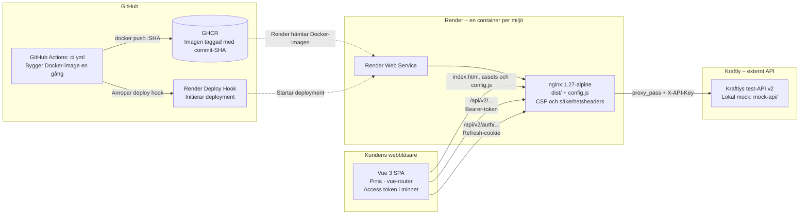

# Architecture – Kraftly Mina sidor

## Översikt

Systemet består av en Vue 3 Single Page Application (SPA), en Nginx-container som serverar frontend-filer och vidarebefordrar API-anrop, samt Kraftlys externa test-API.

Docker-imagen byggs i GitHub Actions, publiceras till GitHub Container Registry (GHCR) och hämtas av Render vid deployment.

GitHub Actions ansvarar för CI-processen och initierar deployment via en Render Deploy Hook. Render hämtar den publicerade Docker-imagen från GHCR och kör applikationen i respektive miljö.

## Arkitekturdiagram

## Komponenter

### Vue 3 SPA

- Vue 3 används för användargränssnittet.
- Pinia hanterar applikationens tillstånd.
- vue-router hanterar navigering.
- Access token lagras i minnet.
- Frontendens API-anrop skickas via Nginx.
- Refresh-cookie används för autentiseringsflödet enligt projektets konfiguration.

### Nginx

- Serverar frontendens byggda filer från `dist/`.
- Serverar `config.js`, som används för frontendens runtime-konfiguration.
- Vidarebefordrar API-anrop till det externa API:t med `proxy_pass`.
- Hanterar CSP och säkerhetsheaders.
- Konfigurerar vidarebefordran av `X-API-Key` till det externa API:t.

### GitHub Actions och GHCR

GitHub Actions ansvarar för CI-processen och byggandet av Docker-imagen.

- GitHub Actions bygger Docker-imagen.
- Imagen taggas med commitens SHA.
- Imagen publiceras till GitHub Container Registry (GHCR).
- GitHub Actions anropar Render via en Deploy Hook för att initiera deployment.

GHCR används som container registry för projektets Docker-images.

### Render

Render används för att köra applikationens container i respektive miljö.

Render hämtar Docker-imagen från GHCR och startar applikationen vid deployment.

Enligt projektets deployment-konfiguration används staging före produktion.

Deployment initieras via en Render Deploy Hook från GitHub Actions.

### Externt API

Kraftlys test-API v2 ligger utanför teamets ägarskap.

Under lokal utveckling kan en mock-API användas för att simulera API-kommunikation.

Den externa API-kommunikationen sker via Nginx, som fungerar som reverse proxy mellan frontend och API.

## API-kommunikation och säkerhet

Frontend skickar API-anrop via Nginx.

Nginx vidarebefordrar anropen till Kraftlys externa test-API v2 med `proxy_pass` och konfigurerar `X-API-Key`.

Access token lagras i minnet och används för autentiserade API-anrop.

Refresh-cookie används endast för autentiseringsflödet enligt projektets konfiguration. I diagrammet representeras detta av anrop till `/api/v2/auth/`.

API-nycklar ska hanteras på serversidan och inte exponeras i frontendens publika filer.

Nginx ansvarar för att vidarebefordra API-anrop och tillämpa de säkerhetsinställningar som definierats i projektets konfiguration.

## Deployment-flöde

Deployment-flödet består av följande steg:

1. En ändring pushas till GitHub.
2. GitHub Actions kör CI-workflowen.
3. Docker-imagen byggs och taggas med commitens SHA.
4. Imagen publiceras till GHCR.
5. GitHub Actions anropar Render via en Deploy Hook.
6. Render hämtar Docker-imagen från GHCR.
7. Render deployar imagen i aktuell miljö.
8. Nginx startar och serverar frontendens byggda filer samt vidarebefordrar API-anrop.

Staging används före produktion enligt projektets deployment-konfiguration.

## Begränsningar

Diagrammet visar systemets huvudsakliga komponenter och kommunikationsvägar.

Det beskriver den avsedda arkitekturen, men exakta detaljer om följande ska verifieras mot den faktiska implementationen:

- Tokenhantering och autentiseringsflöde.
- Cookie-attribut, exempelvis `HttpOnly`, `Secure` och `SameSite`.
- API-rutter och vidarebefordran av headers.
- Hantering och lagring av API-nycklar.
- Nginx-konfiguration och säkerhetsheaders.
- GitHub Actions-workflow och deployment-hook.
- Render-konfiguration och miljöhantering.

Dokumentationen ska hållas uppdaterad när implementationen eller deployment-konfigurationen förändras.
