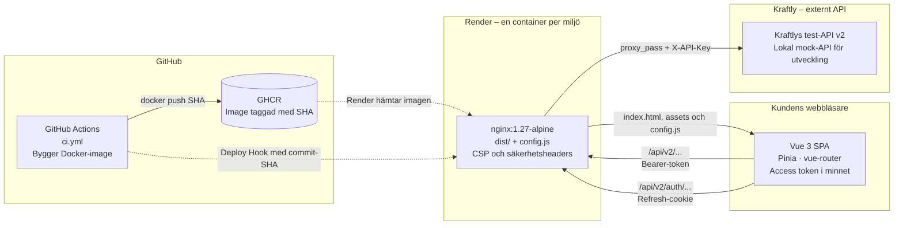

# Architecture – Kraftly Mina sidor

## Översikt

Systemet består av en Vue 3 Single Page Application (SPA), en Nginx-container som serverar frontend-filer och vidarebefordrar API-anrop, samt Kraftlys externa test-API.

Docker-imagen byggs i GitHub Actions, publiceras till GitHub Container Registry (GHCR) och hämtas av Render vid deployment.

## Arkitekturdiagram

## Komponenter

### Vue 3 SPA

- Vue 3 används för användargränssnittet.
- Pinia hanterar applikationens tillstånd.
- vue-router hanterar navigering.
- Access token lagras i minnet enligt diagrammet.

### Nginx

- Serverar frontendens byggda filer från `dist/`.
- Serverar `config.js`.
- Vidarebefordrar API-anrop till det externa API:t.
- Konfigurerar CSP och säkerhetsheaders.

### GitHub Actions och GHCR

- GitHub Actions bygger Docker-imagen.
- Imagen taggas med commitens SHA.
- Imagen publiceras till GHCR.
- Render hämtar imagen vid deployment.

### Render

Render används för att köra applikationens container i respektive miljö. Enligt projektets deployment-konfiguration används staging före produktion.

### Externt API

Kraftlys test-API v2 ligger utanför teamets ägarskap. Under lokal utveckling kan en mock-API användas.

## API-kommunikation och säkerhet

Frontend skickar API-anrop via Nginx. Nginx vidarebefordrar anropen med `proxy_pass` och konfigurerar `X-API-Key`.

Refresh-cookie används endast för autentiseringsflödet enligt projektets konfiguration. API-nycklar ska hanteras på serversidan och inte exponeras i frontendens publika filer.

## Begränsningar

Diagrammet visar systemets huvudsakliga komponenter och kommunikationsvägar. Exakta detaljer om tokenhantering, cookie-attribut, API-rutter och deployment ska verifieras mot den faktiska koden och konfigurationen.
