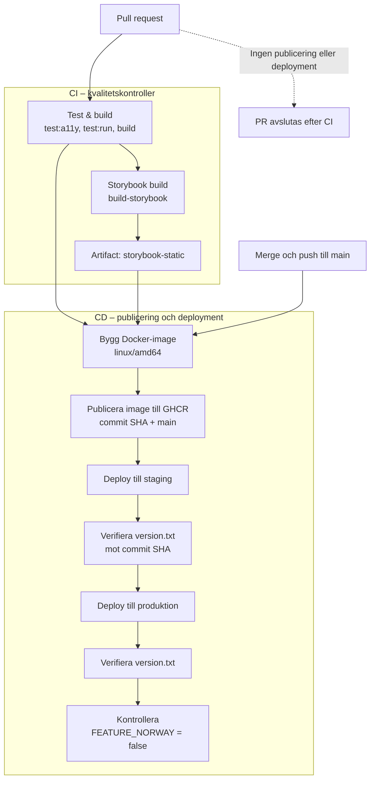

# Pipeline – Kraftly Mina sidor

## Flöde

Diagrammet visar hur kodändringar kontrolleras, byggs och deployas från GitHub till staging och produktion.



## Beslut 1 – Jobb: parallellt eller i serie?

Jobben `verify` och `storybook` är separata och kan köras parallellt. `publish` väntar på att båda ska lyckas.

På pull requests körs kvalitetskontrollerna och Storybook byggs. Docker-imagen byggs också i publiceringsjobbet enligt workflowens beroenden, men publiceras inte till GHCR från en pull request.

Vid push till `main` publiceras imagen till GHCR. Därefter deployas den till staging och sedan till produktion.

Deployment-jobben körs i serie eftersom produktion är beroende av att staging-jobbet lyckas.

## Beslut 2 – Vad krävs för merge?

Workflowen körs vid `pull_request` och vid `push` till `main`.

I workflow-filen finns följande jobb:

- `verify` – kör tillgänglighetstester, applikationstester och produktionsbygge.
- `storybook` – bygger Storybook och sparar artefakten `storybook-static`.

Kontrollera i GitHub-repositoryts branch protection eller ruleset vilka jobb som faktiskt är inställda som required checks.

Om projektets regler kräver en approval, att branchen är uppdaterad och att inga checks får kringgås, ska dessa krav också dokumenteras här.

En viktig skillnad är att ett jobb som finns i workflow-filen inte automatiskt är en required check. Det måste verifieras i repositoryts inställningar.

## Beslut 3 – Protokoll vid röd main

**Ansvarig:** Tech lead enligt teamets arbetsöverenskommelse.

**Åtgärd:** Felet undersöks och hanteras enligt teamets överenskomna tidsgräns.

- Identifiera vilket jobb och vilket steg som misslyckades.
- Läs loggarna i GitHub Actions.
- Åtgärda felet och kör kontrollerna igen.
- Vid ett större fel kan en revert användas för att snabbt återställa en fungerande version.
- Kringgå inte projektets required checks.

Den tidigare dokumenterade tidsgränsen är 45 minuter. Behåll den om den fortfarande gäller enligt teamets arbetsöverenskommelse.

## Byggtid och observerade resultat

I de observerade körningarna var tiderna ungefär:

| Jobb                |  Observerad tid |
| ------------------- | --------------: |
| Test & build        |            30 s |
| Storybook build     |            31 s |
| Image – GHCR        |            38 s |
| Deploy – staging    | Ej dokumenterad |
| Deploy – produktion | Ej dokumenterad |

`verify` och `storybook` körs parallellt. Därför ska deras tider inte adderas som om jobben alltid kördes efter varandra.

Publicering och deployment körs däremot efter att tidigare beroenden har lyckats. Den totala tiden påverkas därför även av Docker-bygget, väntetiden på Render och verifieringen av den deployade versionen.

Tiderna är observerade resultat från specifika körningar och kan variera beroende på runner, cache-status och deploymentens starttid.

### npm-cache

Workflowen använder `actions/setup-node` med `cache: npm` och installerar beroenden med `npm ci`.

Cachen kan minska tiden för beroendehantering genom att återanvända nedladdade npm-paket mellan körningar. Den garanterar inte att varje steg eller hela pipelinen blir snabbare.

Jämförelser mellan körningar före och efter cacheändringen ska baseras på dokumenterade mätningar. Om resultaten inte är jämförbara ska de inte presenteras som en säker prestandaförbättring.

## Lokala tester

Dokumentera resultaten från de senaste faktiska körningarna.

- `npm run test:a11y` – tillgänglighetstester.
- `npm run test:run` – applikationstester.
- `npm run build` – bygger applikationen.
- `npm run build-storybook` – bygger Storybook.
- `npx playwright test` – kör Playwright-testerna, om Playwright är konfigurerat i projektet.

Om Playwright körs via ett separat workflow eller ingår i något av npm-skripten ska det framgå av den faktiska konfigurationen. Lägg inte till Playwright som ett separat CI-jobb i dokumentationen om det inte finns i workflowen.

### Playwright – fel efter ändrade kunduppgifter

#### Bakgrund

Efter att kunduppgifterna ändrades från Anna Andersson till Suzan misslyckades två Playwright-tester vid lokal körning med `npx playwright test`.

Följande tester påverkades:

- `e2e/nav.spec.js` – `navigation between different pages work`
- `e2e/smoke.spec.js` – `kunden kan logga in och ser sin översikt`

Båda testerna loggar in med e-postadressen `anna.andersson@example.com` och lösenordet som anges i testkoden. Efter inloggningen förväntar sig testerna rubriken `Hej Anna!`, men applikationen visar `Hej Suzan!`.

#### Felmeddelande

Playwright rapporterade:

```text
Error: expect(locator).toHaveText(expected) failed

Expected: "Hej Anna!"
Received: "Hej Suzan!"
```

Felet uppstår eftersom det förväntade värdet i testet inte överensstämmer med texten som visas i applikationen.

Det betyder inte automatiskt att inloggningen har misslyckats. Playwright hittar rubriken, men innehållet är annorlunda än det som testet förväntar sig.

#### Orsak

Testerna innehåller fortfarande den gamla förväntningen:

```js
await expect(page.getByRole("heading", { level: 1 })).toHaveText("Hej Anna!");
```

Samtidigt visar applikationen `Hej Suzan!`. Det kan bero på att testkontots namn eller testdata har ändrats, eller att e-postadressen nu är kopplad till en annan testprofil.

Den faktiska kopplingen mellan e-postadressen och testkontot behöver kontrolleras innan testet ändras.

#### Åtgärd

Om Suzan är den avsedda testkunden ska förväntningen uppdateras i båda testfilerna:

```js
await expect(page.getByRole("heading", { level: 1 })).toHaveText("Hej Suzan!");
```

Om testerna i stället ska verifiera Anna Anderssons konto ska testdatan eller kontokopplingen korrigeras. Ändra inte bara förväntningen för att få testet att passera.

För att göra testerna mer robusta bör varje test använda en tydligt definierad testanvändare med ett förväntat namn som överensstämmer med testkontot.

#### Verifiering efter ändringen

Kör först de två berörda testerna separat:

```bash
npx playwright test e2e/nav.spec.js
npx playwright test e2e/smoke.spec.js
```

Kör därefter hela Playwright-testsviten:

```bash
npx playwright test
```

Kontrollera att testerna passerar och att navigeringen till Fakturor, Flyttanmälan och Mina uppgifter fungerar som förväntat.

Om ett test fortfarande misslyckas ska felmeddelandet och den faktiska sidtexten undersökas innan fler ändringar görs.

#### Resultat och lärdom

Det dokumenterade felet visar att testernas förväntningar inte längre stämmer med det namn som applikationen visar.

När testdata eller kunduppgifter ändras måste berörda tester ses över. Målet är inte bara att få testerna att passera, utan att säkerställa att de fortfarande verifierar rätt funktionalitet.

En lyckad lokal körning ska dokumenteras som verifierad först när testerna faktiskt har körts och passerat.

## Deployment och versionskontroll

### Docker och GHCR

Publiceringsjobbet bygger en Docker-image för `linux/amd64`.

Imagen får två taggar:

- Commitens SHA, som identifierar en specifik version.
- `main`, som pekar på den senast publicerade versionen från den branchen.

På push till `main` publiceras imagen till GitHub Container Registry (GHCR).

### Staging

Staging-jobbet körs efter lyckad publicering. Render får instruktioner att använda imagen med den aktuella commitens SHA.

Workflowen kontrollerar därefter `version.txt` i upp till fem minuter. Om värdet inte motsvarar förväntad SHA markeras jobbet som misslyckat.

### Produktion

Produktionsjobbet körs först efter att staging-jobbet har lyckats.

Efter deployment kontrolleras `version.txt` mot commitens SHA. Om `PROD_URL` saknas hoppar den aktuella workflowen över SHA-verifieringen med en varning.

Slutligen kontrolleras att `FEATURE_NORWAY` är avstängd i produktion.

## Säkerhet och felhantering

- Workflowen har `contents: read` som standardbehörighet.
- Publiceringsjobbet får `packages: write` för att kunna publicera till GHCR.
- Docker-imagen publiceras inte från pull requests.
- Deployment-jobben körs endast vid push till `main`.
- Staging måste lyckas innan produktion startar.
- Commit-SHA används för att identifiera och verifiera den deployade versionen.
- Deploy Hooks lagras som GitHub Actions secrets.
- Deployment-verifieringen kan misslyckas om den förväntade versionen inte blir tillgänglig inom tidsgränsen.
- Playwright-fel ska undersökas mot aktuell testdata och applikationens faktiska resultat innan testerna ändras.

En lyckad pipeline är inte i sig ett bevis på att en automatisk rollback har genomförts. Rollback ska dokumenteras som en separat funktion endast om den faktiskt är implementerad och verifierad.

## Skärmdumpar

Behåll skärmdumpar som visar de resultat som faktiskt har verifierats.

### Pipeline och tester

- Lokal Playwright-körning: `img/local-test-playwright-10.png`
- Verify utan cache: `img/verify-utan-cache-3.png`
- Build utan cache: `img/build_utan-cache-4.png`
- Playwright utan cache: `img/all-checks-passed-utan-cache-2.png`
- Verify med cache: `img/verify-med-cache-7.png`
- Build med cache: `img/build_med-cache-8.png`
- Playwright med cache: `img/all-checks-passed-med-cache-6.png`

### Playwright – ändrade kunduppgifter

Följande bilder dokumenterar felet som uppstod när testerna förväntade sig Anna Andersson, medan applikationen visade Suzan:

- `img/not-error-context-spara-anna-inte-suzan.png`
- `img/error-context-spara-suzan-inte-anna.png`

Bilderna kompletterar felbeskrivningen och visar skillnaden mellan testernas förväntade resultat och applikationens faktiska resultat.

### Merge-regler

- Låst merge-knapp: `img/14.png`
- Övriga skärmdumpar av required checks: `img/11.png`, `img/12.png`, `img/13.png` och `img/15.png`

### Flödesdiagram

Det uppdaterade CI/CD-flödesdiagrammet finns här:

`img/CI_CD_Workflow.png`

Den tidigare draw.io-bilden kan också behållas om den fortfarande stämmer med workflowen:

`img/Flowchart-diagram-ci.drawio.png`

Kontrollera att bilderna finns i repositoryt och att filnamnen stämmer exakt med sökvägarna i dokumentationen.

## Underhåll av dokumentationen

Uppdatera denna fil när workflowen ändras, till exempel när nya tester, Storybook-jobb, artefakter, Docker-publicering eller deployment-kontroller läggs till eller tas bort.

Dokumentera även relevanta testfel, deras verifierade orsaker och åtgärder när ändringar i testdata eller kunduppgifter påverkar automatiserade tester.

Dokumentationen ska beskriva den konfiguration som faktiskt finns i `.github/workflows/ci.yml` och resultaten från verifierade körningar. Skilj alltid mellan planerade kontroller, observerade resultat och funktioner som faktiskt är implementerade.
