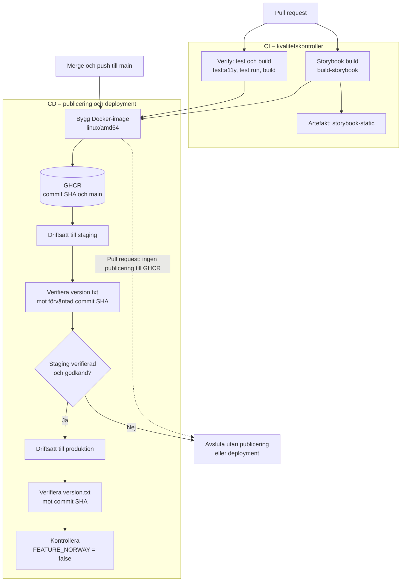

# Pipeline – Kraftly Mina sidor

Det här dokumentet beskriver projektets CI/CD-pipeline, från kodändringar och automatiserade kvalitetskontroller till publicering av Docker-avbildningar och deployment till staging och produktion.

Dokumentationen omfattar även merge-regler, testning, prestandamätningar, felsökning och säkerhet. Målet är att göra det tydligt hur pipeline-flödet fungerar, vilka kontroller som utförs och hur fel ska hanteras.

## 1. Översikt över pipeline-flödet

Diagrammet visar hur kodändringar kontrolleras, byggs och deployas/driftsätts från GitHub till staging och produktion.



Diagrammet beskriver det avsedda flödet enligt den dokumenterade konfigurationen. Kontrollera alltid `.github/workflows/ci.yml` för att säkerställa att beroenden, villkor och jobb överensstämmer med diagrammet.

## 2. CI – automatiserade kvalitetskontroller

CI (Continuous Integration) används för att kontrollera kodändringar innan de går vidare till publicering och deployment.

### 2.1 Verify

Jobbet `verify` kör följande kontroller:

- `npm run test:a11y` – tillgänglighetstester.
- `npm run test:run` – applikationstester.
- `npm run build` – bygger applikationen för produktion.

Syftet är att upptäcka fel tidigt och säkerställa att applikationen kan testas och byggas.

### 2.2 Storybook

Jobbet `storybook` kör:

```bash
npm run build-storybook
```

Det genererar en statisk version av Storybook som sparas som artefakten `storybook-static`.

Artefakten kan användas för att granska komponenter och deras dokumentation separat från den vanliga applikationen.

### 2.3 Parallell körning och beroenden

Jobben `verify` och `storybook` är separata och kan köras parallellt om workflow-konfigurationen inte anger andra beroenden.

Publiceringsjobbet ska vänta tills de obligatoriska föregående jobben har lyckats.

På pull requests körs kvalitetskontrollerna och Storybook byggs. Docker-imagen kan även byggas som en del av publiceringsjobbet, men ska inte publiceras till GHCR från en pull request.

Vid push till `main` publiceras imagen och deploymenten kan fortsätta enligt pipeline-flödet.

Kontrollera `needs`, `if` och eventuella andra villkor i workflow-filen för att verifiera det faktiska beroendeflödet.

## 3. CD – publicering och deployment

CD (Continuous Delivery/Deployment) hanterar publiceringen av Docker-imagen och deploymenten till de olika miljöerna.

### 3.1 Bygg och publicera Docker-imagen

Publiceringsjobbet bygger en Docker-avbildning för plattformen `linux/amd64`.

Imagen publiceras till GitHub Container Registry (GHCR) med två taggar:

- Commitens SHA, som identifierar en specifik kodversion.
- `main`, som används för att referera till den senast publicerade versionen från den branchen.

Commit-SHA används för att verifiera vilken version som faktiskt har driftsatts.

Publiceringen sker vid push till `main`, enligt den dokumenterade workflow-konfigurationen. Pull requests ska inte publicera avbildningar till GHCR.

### 3.2 deployment till staging

Staging-jobbet körs efter att publiceringen har lyckats.

Render konfigureras att använda Docker-imagen som motsvarar den aktuella commitens SHA.

Efter deploymenten kontrollerar workflowen `version.txt` för att verifiera att rätt version körs.

Enligt den dokumenterade konfigurationen görs verifieringen i upp till fem minuter. Om det rapporterade versionsvärdet inte motsvarar den förväntade SHA-markeras jobbet som misslyckat.

### 3.3 Deployment till produktion

Produktionsjobbet körs först efter att staging-jobbet har lyckats.

Efter deploymenten jämförs värdet i `version.txt` med den förväntade commit-SHA:n.

Om `PROD_URL` saknas hoppar den aktuella workflowen över SHA-verifieringen och visar en varning. Detta innebär att versionskontrollen inte kan betraktas som genomförd i det fallet.

Slutligen kontrolleras att funktionen `FEATURE_NORWAY` är avstängd i produktion.

### 3.4 Ordning och verifiering

Deploymenten sker i följande ordning:

1. Bygg Docker-imagen.
2. Publicera imagen till GHCR.
3. Driftsätt till staging.
4. Verifiera den driftsatta versionen.
5. Gå vidare till produktion först när staging-jobbet har lyckats.
6. Verifiera produktionsversionen.
7. Kontrollera att `FEATURE_NORWAY` är avstängd.

En lyckad staging-verifiering är därmed en förutsättning för att produktionsjobbet ska starta, enligt det dokumenterade flödet.

## 4. Merge-regler och krav på pull requests

Workflowen körs vid:

- `pull_request`
- `push` till `main`

I workflow-filen finns bland annat jobben `verify` och `storybook`. Publicerings- och deploymentsjobben följer sina respektive villkor.

### 4.1 Required checks

Att ett jobb finns i `.github/workflows/ci.yml` innebär inte automatiskt att jobbet är ett obligatoriskt krav för merge.

Kontrollera därför GitHub-repositoryts inställningar för branch protection eller rulesets för att fastställa:

- Vilka jobb som måste lyckas innan merge.
- Om minst en godkänd granskning krävs.
- Om branchen måste vara uppdaterad med målbranchen.
- Om det finns andra regler som påverkar möjligheten att slå samman en pull request.

Dokumentera endast de merge-regler som faktiskt är konfigurerade i repositoryt.

## 5. Hantering av röd main

När `main` har en misslyckad pipeline ska felet undersökas och hanteras enligt teamets arbetsöverenskommelse.

**Ansvarig:** Tech lead enligt teamets arbetsöverenskommelse.

### Åtgärdsplan

1. Identifiera vilket jobb och vilket steg som misslyckades.
2. Läs felloggarna i GitHub Actions.
3. Undersök grundorsaken och avgör om felet beror på kod, testdata, konfiguration eller miljö.
4. Åtgärda felet och kör relevanta kontroller igen.
5. Vid ett större fel kan en revert användas för att snabbt återställa en tidigare fungerande kodversion.
6. Verifiera att den korrigerade versionen passerar relevanta kontroller.

Kringgå inte projektets obligatoriska kontroller för att få en merge att gå igenom.

Den tidigare dokumenterade tidsgränsen för hantering av röd main är 45 minuter. Behåll tidsgränsen endast om den fortfarande gäller enligt teamets aktuella arbetsöverenskommelse.

## 6. Byggtid och prestandamätningar

I de dokumenterade körningarna observerades ungefär följande tider:

| Jobb                       |  Observerad tid |
| -------------------------- | --------------: |
| Test och build             |     30 sekunder |
| Storybook build            |     31 sekunder |
| Docker-avbildning och GHCR |     38 sekunder |
| Deployment till staging    | Ej dokumenterad |
| Deployment till produktion | Ej dokumenterad |

Tiderna är observerade resultat från specifika körningar och ska inte betraktas som garanterade byggtider.

### 6.1 Hur tiderna ska tolkas

Jobben `verify` och `storybook` kan köras parallellt. Därför ska deras tider inte adderas som om de alltid kördes efter varandra.

Publicering och deployment sker efter att föregående beroenden har lyckats. Den totala tiden påverkas därför även av:

- Docker-bygget.
- Publiceringen till GHCR.
- Render-tjänstens start- och deploymentstid.
- Väntetiden vid versionsverifieringen.
- Eventuella omförsök och cacheförhållanden.

För en rättvis jämförelse bör mätningar göras under jämförbara förhållanden.

### 6.2 npm-cache

Workflowen använder `actions/setup-node` med `cache: npm` och installerar beroenden med `npm ci`.

Npm-cachen kan minska tiden för beroendehantering genom att återanvända tidigare nedladdade paket.

Cachen garanterar dock inte att varje jobb eller hela pipelinen blir snabbare.

Jämförelser före och efter en cacheändring ska baseras på dokumenterade mätningar. Om körningarna skiljer sig åt i exempelvis cache-status, runner eller belastning ska resultaten tolkas med försiktighet.

## 7. Lokal testning

Följande kommandon används för att kontrollera applikationen lokalt:

| Kommando                  | Syfte                                            |
| ------------------------- | ------------------------------------------------ |
| `npm run test:a11y`       | Tillgänglighetstester                            |
| `npm run test:run`        | Applikationstester                               |
| `npm run build`           | Produktionsbygge                                 |
| `npm run build-storybook` | Bygge av Storybook                               |
| `npx playwright test`     | Playwright-tester, om Playwright är konfigurerat |

Kör relevanta tester innan du skickar in en pull request.

Playwright kan köras separat lokalt eller genom ett särskilt workflow. Dokumentera det som en separat CI-kontroll endast om den faktiskt finns i konfigurationen.

Resultat ska rapporteras som godkända först efter att testerna har körts och passerat.

## 8. Felsökning: Playwright efter ändrade kunduppgifter

### 8.1 Bakgrund

Efter att kunduppgifterna ändrades från Anna Andersson till Suzan misslyckades två Playwright-tester vid lokal körning med:

```bash
npx playwright test
```

Följande tester påverkades:

- `e2e/nav.spec.js` – `navigation between different pages work`
- `e2e/smoke.spec.js` – `kunden kan logga in och ser sin översikt`

Båda testerna loggar in med e-postadressen `anna.andersson@example.com` och lösenordet som anges i testkoden.

Efter inloggningen förväntar sig testerna rubriken `Hej Anna!`, men applikationen visar `Hej Suzan!`.

### 8.2 Felmeddelande

Playwright rapporterade följande skillnad:

```text
Error: expect(locator).toHaveText(expected) failed

Expected: "Hej Anna!"
Received: "Hej Suzan!"
```

Felet visar att Playwright hittar rubriken, men att dess faktiska text inte motsvarar det förväntade värdet.

Det innebär inte automatiskt att inloggningen har misslyckats. Felet uppstår vid kontrollen av rubrikens innehåll.

### 8.3 Orsak

Tester­na innehåller fortfarande den gamla förväntningen:

```js
await expect(page.getByRole("heading", { level: 1 })).toHaveText("Hej Anna!");
```

Samtidigt visar applikationen `Hej Suzan!`.

En möjlig förklaring är att testkontots namn eller testdata har ändrats, eller att e-postadressen nu är kopplad till en annan testprofil.

Den faktiska kopplingen mellan e-postadressen och testkontot behöver kontrolleras innan testet ändras.

### 8.4 Åtgärd

Om Suzan är den avsedda testkunden ska förväntningen uppdateras i båda testfilerna:

```js
await expect(page.getByRole("heading", { level: 1 })).toHaveText("Hej Suzan!");
```

Om testerna i stället ska verifiera Anna Anderssons konto ska testdata eller kontokopplingen korrigeras.

Ändra inte enbart den förväntade texten för att få testerna att passera. Testerna ska verifiera rätt kund och rätt beteende.

För att göra testerna mer robusta bör varje test använda en tydligt definierad testanvändare med testdata som stämmer överens med de förväntningar som används.

### 8.5 Verifiering efter ändringen

Kör först de två berörda testerna separat:

```bash
npx playwright test e2e/nav.spec.js
npx playwright test e2e/smoke.spec.js
```

Kör därefter hela Playwright-testsviten:

```bash
npx playwright test
```

Kontrollera att:

- Inloggningen fungerar med avsedd testanvändare.
- Rätt välkomsttext visas.
- Navigeringen till Fakturor fungerar.
- Navigeringen till Flyttanmälan fungerar.
- Navigeringen till Mina uppgifter eller profilsidan fungerar.
- Testerna verifierar det förväntade resultatet, inte bara att sidorna kan öppnas.

Om ett test fortfarande misslyckas ska felmeddelandet, testdatan och sidans faktiska innehåll undersökas innan ytterligare ändringar görs.

### 8.6 Resultat och lärdom

Det dokumenterade felet visar att testernas förväntningar inte längre stämmer med namnet som visas i applikationen.

När kunduppgifter eller testdata ändras behöver berörda automatiserade tester ses över. Målet är att testerna ska verifiera rätt funktionalitet, inte enbart att de ska passera.

En lyckad testkörning ska dokumenteras som verifierad först när testerna faktiskt har körts och passerat.

## 9. Säkerhet och felhantering

Följande säkerhets- och verifieringsprinciper gäller för den dokumenterade pipelinen:

- Workflowen använder `contents: read` som standardbehörighet.
- Publiceringsjobbet får `packages: write` för att kunna publicera Docker-avbildningar till GHCR.
- Docker-avbildningar publiceras inte från pull requests.
- Deploymentsjobben körs endast vid push till `main`, enligt den dokumenterade konfigurationen.
- Staging måste lyckas innan produktion startar.
- Commit-SHA används för att identifiera och verifiera den driftsatta versionen.
- Deploy Hooks lagras som GitHub Actions secrets.
- Saknad konfiguration eller felaktig versionsinformation kan leda till att verifieringen misslyckas.
- Playwright-fel ska undersökas mot aktuell testdata och applikationens faktiska resultat innan testerna ändras.

### Rollback och återställning

En misslyckad pipeline innebär inte i sig att en automatisk rollback har genomförts.

Om en tidigare version behöver återställas kan en revert användas för att återställa kodändringar. Det är dock inte samma sak som en automatisk rollback av en redan driftsatt Docker-avbildning.

Dokumentera automatisk rollback som en funktion endast om den är implementerad och verifierad.

## 10. Skärmdumpar och verifieringsunderlag

Skärmdumpar kan användas som kompletterande underlag för pipeline-resultat, testfel och repository-inställningar.

Behåll endast referenser till bilder som faktiskt finns i repositoryt.

### 10.1 Pipeline och tester

| Beskrivning              | Fil                                      |
| ------------------------ | ---------------------------------------- |
| Lokal Playwright-körning | `img/local-test-playwright-10.png`       |
| Verify utan cache        | `img/verify-utan-cache-3.png`            |
| Build utan cache         | `img/build_utan-cache-4.png`             |
| Playwright utan cache    | `img/all-checks-passed-utan-cache-2.png` |
| Verify med cache         | `img/verify-med-cache-7.png`             |
| Build med cache          | `img/build_med-cache-8.png`              |
| Playwright med cache     | `img/all-checks-passed-med-cache-6.png`  |

Dessa bilder kan användas för att jämföra körningar med och utan npm-cache. Dra inte slutsatser om prestandaförbättringar utan att resultaten är jämförbara.

### 10.2 Playwright – ändrade kunduppgifter

Följande filer anges som dokumentation av felet där testerna förväntade sig Anna Andersson, medan applikationen visade Suzan:

- `img/not-error-context-spara-anna-inte-suzan.png`
- `img/error-context-spara-suzan-inte-anna.png`

Bilderna kompletterar felbeskrivningen genom att visa skillnaden mellan testernas förväntade resultat och applikationens faktiska resultat.

### 10.3 Merge-regler

Följande bilder anges som underlag för repositoryts merge-regler och required checks:

- Låst merge-knapp: `img/14.png`
- Övriga skärmdumpar av required checks: `img/11.png`, `img/12.png`, `img/13.png` och `img/15.png`

Använd bilderna som stöd för dokumentationen, men verifiera även de aktuella reglerna direkt i GitHub.

### 10.4 Flödesdiagram

Det uppdaterade CI/CD-flödesdiagrammet anges som:

`img/CI_CD_Workflow.png`

Den tidigare draw.io-bilden kan också behållas om den fortfarande överensstämmer med workflowen:

`img/Flowchart-diagram-ci.drawio.png`

Kontrollera att bilderna finns i repositoryt och att filnamnen stämmer exakt med sökvägarna i dokumentationen.

## 11. Underhåll av dokumentationen

Uppdatera denna fil när pipeline-konfigurationen förändras, till exempel när:

- Nya tester eller jobb läggs till.
- Storybook-jobbet eller artefakthanteringen ändras.
- Docker-publicering eller deployment ändras.
- Versionskontroller eller feature flags ändras.
- Merge-regler uppdateras.
- Testdata påverkar automatiserade tester.
- Säkerhetsbehörigheter eller hemligheter ändras.

Dokumentera relevanta testfel, verifierade orsaker och åtgärder när ändringar i testdata eller kunduppgifter påverkar automatiserade tester.

Dokumentationen ska alltid spegla den faktiska konfigurationen i `.github/workflows/ci.yml` och resultaten från verifierade körningar.

Skilj mellan planerade kontroller, observerade resultat och funktioner som faktiskt är implementerade. På så sätt förblir dokumentationen tillförlitlig och användbar för hela teamet.
