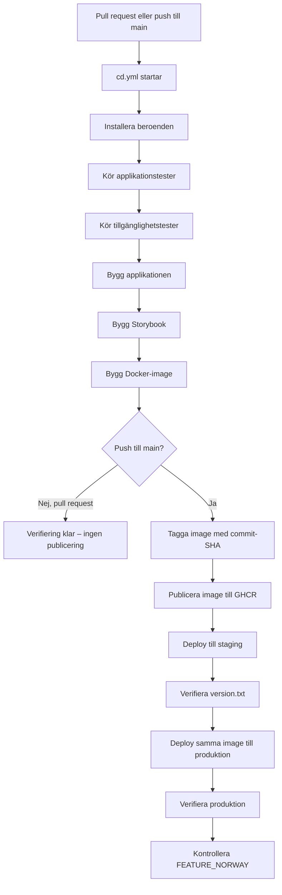
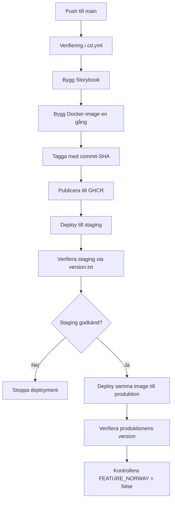

# Pipeline – Kraftly Mina sidor

## Syfte

Det här dokumentet beskriver projektets CI/CD-flöde, från kodändringar och automatiserade kvalitetskontroller till publicering av Docker-avbildningar och driftsättning till staging och produktion.

Dokumentationen beskriver även workflow-jobb, merge-regler, testning, prestandamätningar, felsökning och säkerhet.

Målet är att göra det tydligt vilka kontroller som utförs, hur applikationen byggs och hur rätt version verifieras i respektive miljö.

## 1. Översikt över pipeline-flödet

Projektet använder ett gemensamt GitHub Actions-workflow:

- `cd.yml` hanterar både CI (Continuous Integration) och CD (Continuous Delivery/Deployment).
- Workflowen innehåller automatiserade tester, tillgänglighetskontroller, produktionsbygge, Storybook-bygge, Docker-publicering och deployment.
- Vid pull requests körs verifieringsstegen, men Docker-avbildningen publiceras inte till GHCR.
- Vid push till `main` kan den verifierade Docker-avbildningen publiceras och driftsättas till staging och därefter produktion.

Det innebär att projektets kvalitetskontroller och deployment hanteras i samma workflow i stället för i två separata workflow-filer.

### 1.1 CI/CD – från kodändring till produktion



### 1.2 Deploymentflöde



Diagrammen visar huvudflödet i `cd.yml`. Det första beskriver både verifiering och deployment. Det andra fokuserar på publicering och driftsättning mellan miljöerna.

Exakta triggers, villkor och beroenden ska alltid kontrolleras i `.github/workflows/cd.yml`.

## 2. CI – automatiserade kvalitetskontroller

CI (Continuous Integration) används för att kontrollera kodändringar automatiskt.

### 2.1 Workflow: `cd.yml`

Det gemensamma workflowet körs vid:

- `pull_request`
- `push` till `main`

Verifieringsstegen omfattar:

- `npm ci` – installerar beroenden.
- `npm run test:a11y` – kör tillgänglighetstester.
- `npm run test:run` – kör applikationstester.
- `npm run build` – bygger applikationen för produktion.

En lyckad körning visar att dessa kontroller har passerat i den aktuella körningen.

Vid pull requests körs verifieringen, men Docker-avbildningen publiceras inte till GHCR och ingen deployment till staging eller produktion genomförs.

Vid push till `main` fortsätter workflowen till publicering och deployment när de föregående stegen har lyckats.

### 2.2 Storybook

Storybook byggs med:

```powershell
npm run build-storybook
```

Resultatet är en statisk Storybook-version som sparas som artefakten `storybook-static`.

Artefakten kan användas för att granska komponenter och deras dokumentation separat från den vanliga applikationen.

Projektet har även ett Storybook-jobb i `cd.yml`.

## 3. CD – publicering och deployment

CD (Continuous Delivery/Deployment) hanterar byggandet, publiceringen och driftsättningen av applikationen.

### 3.1 Bygg Docker-avbildningen

Docker-avbildningen byggs för plattformen `linux/amd64`.

Avbildningen byggs en gång i publiceringsflödet och identifieras med commitens SHA.

Detta gör det möjligt att koppla den driftsatta versionen till en specifik kodversion.

### 3.2 Publicering till GHCR

Docker-avbildningen publiceras till GitHub Container Registry (GHCR).

Den får följande taggar:

- Commitens SHA – identifierar en specifik version.
- `main` – refererar till den senast publicerade versionen från `main`.

Publicering till GHCR sker vid push till `main`, inte från pull requests.

Pull requests kan bygga Docker-avbildningen för verifiering, men ska inte publicera den till registret.

### 3.3 Deployment till staging

Efter att publiceringen har lyckats kan staging-jobbet starta.

Render driftsätter Docker-avbildningen som motsvarar den aktuella commitens SHA.

Efter deploymenten kontrolleras:

- Att staging svarar.
- Att `/version.txt` innehåller den förväntade commit-SHA.

Workflowen försöker verifiera versionen under en begränsad väntetid, upp till fem minuter enligt den dokumenterade konfigurationen.

Om versionsvärdet inte motsvarar förväntad SHA misslyckas verifieringen.

### 3.4 Deployment till produktion

Produktionsjobbet är beroende av att staging-jobbet har lyckats.

Produktionen driftsätts med samma Docker-avbildning och commit-SHA som användes i staging.

Efter deploymenten försöker workflowen verifiera produktionsversionen genom `/version.txt`.

Om `PROD_URL` saknas hoppas versionsverifieringen över och en varning visas. I det läget kan produktionsversionen inte betraktas som verifierad av workflowen.

Slutligen kontrolleras att `FEATURE_NORWAY` är avstängd i produktion.

### 3.5 Sammanfattning av deploymentordningen

1. Starta `cd.yml` vid pull request eller push till `main`.
2. Installera beroenden.
3. Kör applikationstester och tillgänglighetstester.
4. Bygg applikationen för produktion.
5. Bygg Storybook.
6. Bygg Docker-avbildningen.
7. Vid pull request: avsluta efter verifieringen utan publicering eller deployment.
8. Vid push till `main`: tagga avbildningen med commit-SHA.
9. Publicera avbildningen till GHCR.
10. Driftsätt samma SHA till staging.
11. Verifiera `/version.txt` i staging.
12. Driftsätt samma SHA till produktion efter godkänd staging.
13. Verifiera produktionens `/version.txt` om `PROD_URL` är konfigurerad.
14. Kontrollera att `FEATURE_NORWAY` är avstängd i produktion.

Det är viktigt att skilja mellan att en deployment har startat och att den driftsatta versionen har verifierats.

## 4. Merge-regler och pull requests

Det gemensamma workflowet `cd.yml` körs vid pull requests och push till `main`.

Att ett jobb finns i workflow-filen innebär inte automatiskt att det är ett obligatoriskt merge-krav.

Kontrollera GitHub-repositoryts branch protection eller rulesets för att fastställa:

- Vilka checks som måste lyckas före merge.
- Om minst en godkänd granskning krävs.
- Om branchen måste vara uppdaterad med målbranchen.
- Om andra regler påverkar möjligheten att slå samman en pull request.

Dokumentera endast de regler som faktiskt är aktiverade i repositoryt.

## 5. Hantering av röd main

När `main` har en misslyckad pipeline ska felet undersökas och hanteras enligt teamets arbetsöverenskommelse.

**Ansvarig:** Tech lead enligt teamets arbetsöverenskommelse.

### 5.1 Åtgärdsplan

1. Identifiera vilket jobb och steg i `cd.yml` som misslyckades.
2. Läs felloggarna i GitHub Actions.
3. Undersök grundorsaken.
4. Avgör om felet beror på kod, testdata, konfiguration eller miljö.
5. Åtgärda felet och kör relevanta kontroller igen.
6. Vid ett större fel kan en revert användas för att återställa en tidigare fungerande kodversion.
7. Verifiera att den korrigerade versionen passerar relevanta kontroller.

Kringgå inte projektets obligatoriska kontroller för att få en merge att gå igenom.

Den tidigare dokumenterade tidsgränsen för hantering av röd main är 45 minuter. Behåll den endast om den fortfarande gäller enligt teamets aktuella arbetsöverenskommelse.

## 6. Byggtid och prestandamätningar

I tidigare dokumenterade körningar observerades ungefär följande tider:

| Jobb                       | Observerad tid  |
| -------------------------- | --------------- |
| Test och build             | 30 sekunder     |
| Storybook build            | 31 sekunder     |
| Docker-avbildning och GHCR | 38 sekunder     |
| Deployment till staging    | Ej dokumenterad |
| Deployment till produktion | Ej dokumenterad |

Tiderna är observerade resultat från specifika körningar. De ska inte betraktas som garanterade byggtider.

### 6.1 Hur tiderna ska tolkas

Jobben för verifiering och Storybook kan köras parallellt om workflow-konfigurationen tillåter det.

Därför ska deras tider inte adderas som om de alltid kördes efter varandra.

Den totala tiden påverkas även av:

- Docker-bygget.
- Publiceringen till GHCR.
- Render-tjänstens start- och deploymentstid.
- Väntetiden vid versionsverifieringen.
- Eventuella omförsök och cacheförhållanden.

För en rättvis jämförelse bör mätningar göras under jämförbara förhållanden.

### 6.2 npm-cache

Workflowen använder `actions/setup-node` med `cache: npm` och installerar beroenden med `npm ci`.

Npm-cachen kan minska tiden för beroendehantering genom att återanvända tidigare nedladdade paket.

Cachen garanterar däremot inte att varje jobb eller hela pipelinen blir snabbare.

Jämförelser före och efter en cacheändring ska baseras på dokumenterade mätningar. Om körningarna skiljer sig åt i exempelvis cache-status, runner eller belastning ska resultaten tolkas med försiktighet.

Skärmdumpar från GitHub Actions används som kompletterande underlag för körningar med och utan cache. De anges i avsnitt 10.1.

| Körning    | Dokumenterat underlag                                       |
| ---------- | ----------------------------------------------------------- |
| Utan cache | `img/verify-utan-cache-3.png`, `img/build_utan-cache-4.png` |
| Med cache  | `img/verify-med-cache-7.png`, `img/build_med-cache-8.png`   |

Bilderna visar observerade pipeline-körningar. En faktisk tidsvinst ska endast anges om körningarna är jämförbara och resultaten visar en förbättring.

## 7. Lokal testning

Följande kommandon används för att kontrollera applikationen lokalt:

| Kommando                  | Syfte                 |
| ------------------------- | --------------------- |
| `npm run test:a11y`       | Tillgänglighetstester |
| `npm run test:run`        | Applikationstester    |
| `npm run build`           | Produktionsbygge      |
| `npm run build-storybook` | Bygge av Storybook    |
| `npx playwright test`     | Playwright-tester     |

Kör relevanta tester innan du skickar in en pull request.

Playwright kan köras separat lokalt eller genom ett särskilt workflow. Dokumentera det som en separat CI-kontroll endast om det faktiskt finns i workflow-konfigurationen.

Resultat ska rapporteras som godkända först efter att testerna har körts och passerat.

### 7.1 Dokumenterade Playwright-tester

Playwright används för att testa centrala användarflöden.

De dokumenterade testerna omfattar:

- Inloggning och visning av översikten.
- Att felaktigt lösenord nekas.
- Att ingen access token sparas i `localStorage` efter misslyckad inloggning.
- Att en oautentiserad användare skickas till `/login`.
- Att användaren efter inloggning kan återgå till `/fakturor` och se fakturan `F-2026-06`.

En tidigare rapporterad körning visade fem godkända Playwright-tester. Detta resultat ska betraktas som ett dokumenterat testresultat från den körningen, inte som en garanti för framtida körningar.

## 8. Felsökning av testdata

Automatiserade tester kan påverkas när testkonton eller kunduppgifter ändras.

Ett tidigare Playwright-fel uppstod när ett test förväntade sig rubriken `Hej Anna!`, medan applikationen visade `Hej Suzan!`.

Felet visade att testets förväntade text inte stämde med applikationens faktiska resultat. Det bevisade inte i sig att inloggningen hade misslyckats.

Vid liknande fel ska teamet:

1. Kontrollera vilken testanvändare som används.
2. Kontrollera testkontots aktuella uppgifter.
3. Jämföra testets förväntningar med applikationens faktiska resultat.
4. Ändra testdata eller förväntningar först när det är klarlagt vilket resultat som är korrekt.
5. Köra det berörda testet och därefter hela testsviten.

Ändra inte enbart förväntad text för att få ett test att passera. Testet ska verifiera rätt användare och rätt beteende.

## 9. Säkerhet och felhantering

Följande principer gäller för den dokumenterade pipelinen:

- Workflowen använder begränsade behörigheter, bland annat `contents: read` som standard.
- Publiceringsjobbet får `packages: write` för att kunna publicera Docker-avbildningar till GHCR.
- Docker-avbildningar publiceras inte från pull requests.
- Deploymentjobben körs endast vid push till `main`, enligt den dokumenterade konfigurationen.
- Staging måste lyckas innan produktion startar.
- Commit-SHA används för att identifiera och verifiera den driftsatta versionen.
- Deploy Hooks lagras som GitHub Actions secrets.
- Saknad konfiguration eller felaktig versionsinformation kan leda till att verifieringen misslyckas.
- Testfel ska undersökas mot aktuell testdata och applikationens faktiska resultat innan testerna ändras.

### 9.1 Rollback och återställning

En misslyckad pipeline innebär inte i sig att en automatisk rollback har genomförts.

Om en tidigare version behöver återställas kan en revert användas för att återställa kodändringar. Det är dock inte samma sak som en automatisk rollback av en redan driftsatt Docker-avbildning.

Dokumentera automatisk rollback som en funktion endast om den är implementerad och verifierad.

## 10. Skärmdumpar och verifieringsunderlag

Skärmdumpar kan användas som kompletterande underlag för pipeline-resultat, testfel och repository-inställningar.

Behåll endast referenser till bilder som faktiskt finns i repositoryt.

### 10.1 Pipeline och tester

| Beskrivning                | Fil                                      |
| -------------------------- | ---------------------------------------- |
| Lokal Playwright-körning   | `img/local-test-playwright-10.png`       |
| Verify utan cache          | `img/verify-utan-cache-3.png`            |
| Build utan cache           | `img/build_utan-cache-4.png`             |
| Alla kontroller utan cache | `img/all-checks-passed-utan-cache-2.png` |
| Verify med cache           | `img/verify-med-cache-7.png`             |
| Build med cache            | `img/build_med-cache-8.png`              |
| Alla kontroller med cache  | `img/all-checks-passed-med-cache-6.png`  |

Dessa bilder kan användas för att jämföra körningar med och utan npm-cache. Dra inte slutsatser om prestandaförbättringar utan att resultaten är jämförbara.

### 10.2 Playwright – ändrade kunduppgifter

Följande filer anges som dokumentation av det tidigare felet där testerna förväntade sig Anna Andersson, medan applikationen visade Suzan:

- `img/not-error-context-spara-anna-inte-suzan.png`
- `img/error-context-spara-suzan-inte-anna.png`

Bilderna kompletterar felbeskrivningen genom att visa skillnaden mellan testernas förväntade resultat och applikationens faktiska resultat.

### 10.3 Merge-regler

Följande bilder anges som underlag för repositoryts merge-regler och required checks:

- Låst merge-knapp: `img/14.png`
- Övriga skärmdumpar av required checks: `img/11.png`, `img/12.png`, `img/13.png` och `img/15.png`

Använd bilderna som stöd för dokumentationen, men verifiera även de aktuella reglerna direkt i GitHub.

### 10.4 Flödesdiagram

Pipeline-flödet dokumenteras med Mermaid direkt i avsnitt 1. Diagrammen är en del av Markdown-dokumentet och versionshanteras tillsammans med övrig dokumentation.

De tidigare separata diagramfilerna används inte längre:

- `img/CI_CD_Workflow.png`
- `img/Flowchart-diagram-ci.drawio.png`

## 11. Underhåll av dokumentationen

Uppdatera denna fil när pipeline-konfigurationen förändras, till exempel när:

- Nya tester eller jobb läggs till.
- Storybook-jobbet eller artefakthanteringen ändras.
- Docker-publicering eller deployment ändras.
- Versionskontroller eller feature flags ändras.
- Merge-regler uppdateras.
- Testdata påverkar automatiserade tester.
- Säkerhetsbehörigheter eller hemligheter ändras.

Dokumentera relevanta testfel, verifierade orsaker och åtgärder när ändringar i testdata eller kunduppgifter påverkar automatiserade tester.

Dokumentationen ska alltid spegla den faktiska konfigurationen i `.github/workflows/cd.yml`.

Skilj mellan planerade kontroller, observerade resultat och funktioner som faktiskt är implementerade. På så sätt förblir dokumentationen tillförlitlig och användbar för hela teamet.
